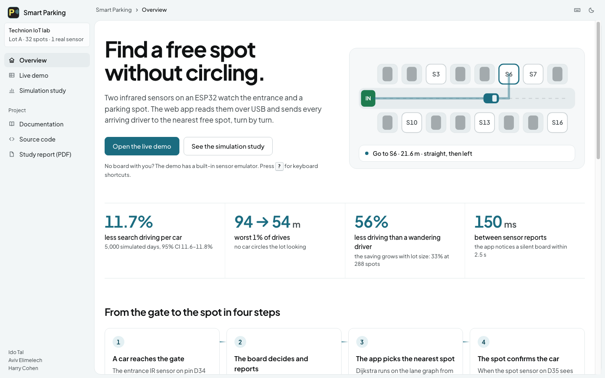
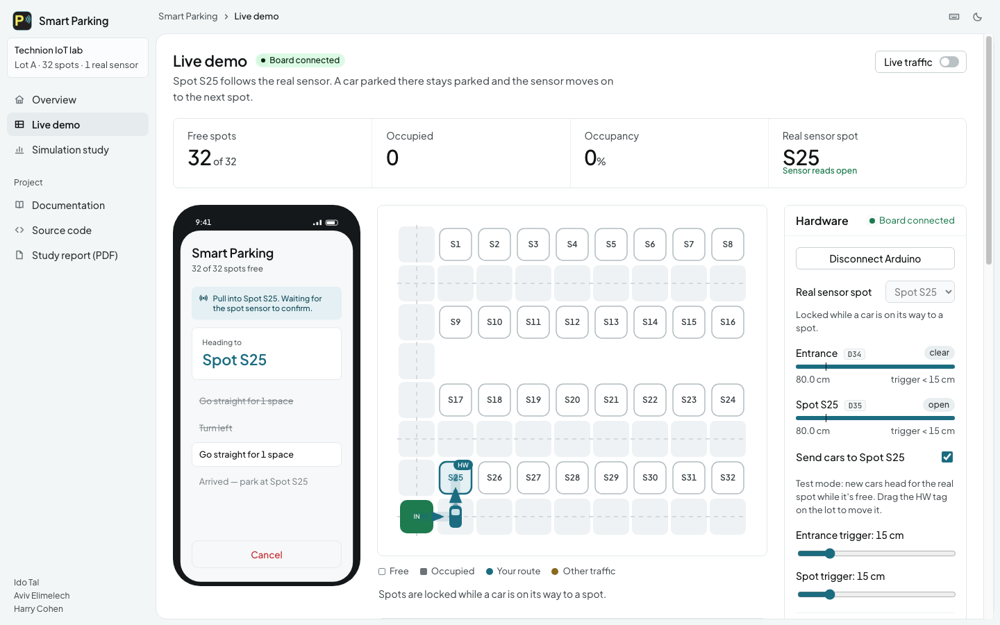
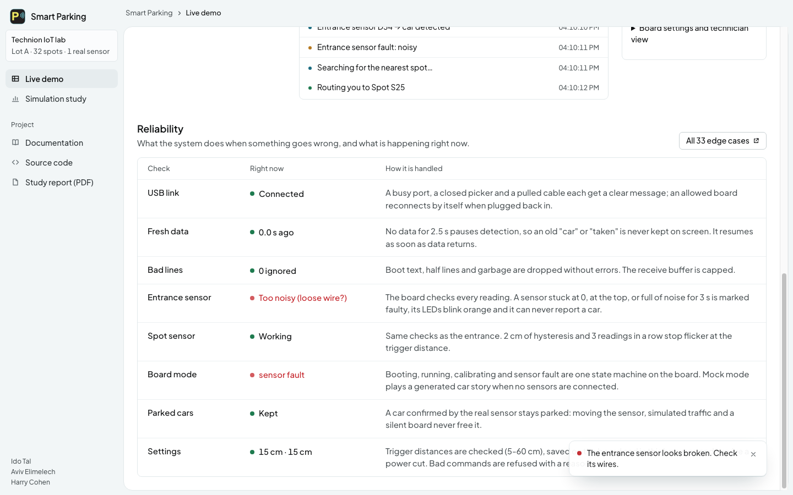
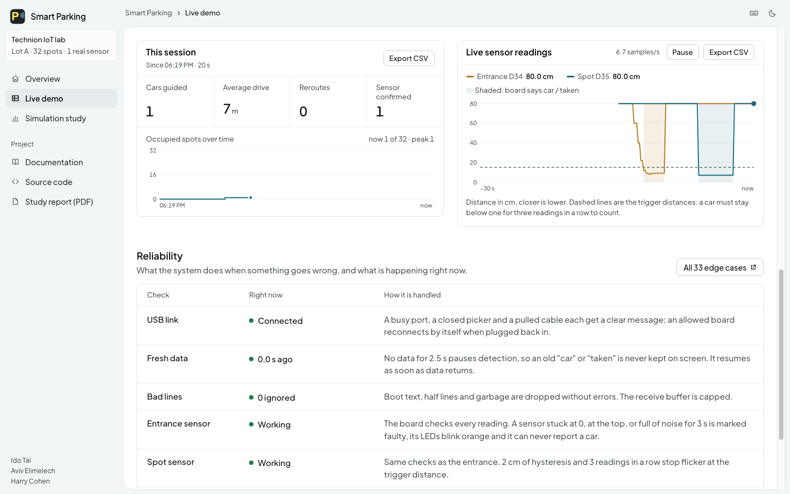
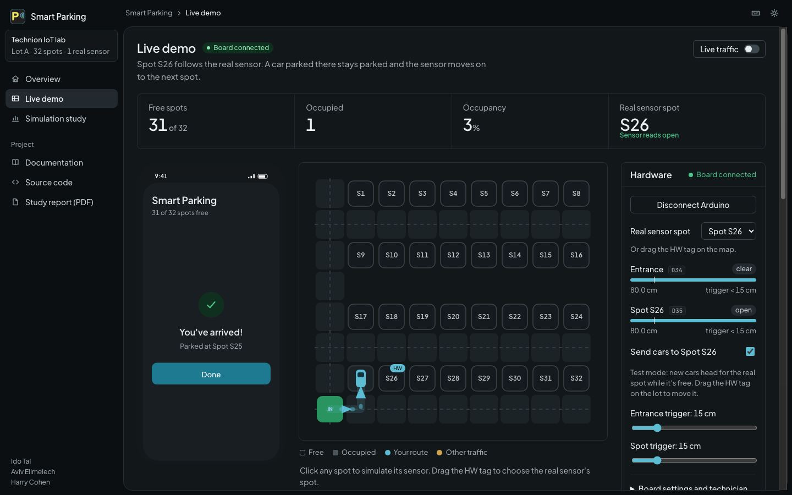

# Smart Parking Lot

[](https://github.com/AvivEli1/SmartParking/actions/workflows/ci.yml)

An IoT parking system: an **ESP32** with two IR sensors and an LED strip senses a car and a parking spot, a
**web app** finds the nearest free spot (Dijkstra) and guides the driver there, and a **simulation study**
measures how much driving that saves.





*(screenshots use a simulated board)*

## What it does

- **Senses** a car at the entrance (IR sensor on D34) and whether the parking spot is taken (D35).
- **Decides on the board:** the ESP32 debounces the readings, decides "car" and "spot taken", and shows it on an LED strip (D26)
  even when no computer is connected: green = free, red = taken.
- **Guides:** the web app routes the car to the nearest free spot with turn-by-turn directions on a phone mockup and a live lot map.
- **Is robust:** it notices a broken sensor, a silent board and an unplugged cable, rejects bad input, keeps its
  settings through a power cycle, and has a mock mode that needs no sensors. The live demo's **Reliability**
  section shows these checks working in real time; every case is listed in [docs/EDGE_CASES.md](docs/EDGE_CASES.md).


- **Is configurable** from the app: trigger distances, one-click calibration, LED brightness, mock mode.
- **Shows its data:** a live graph of both IR sensors with their trigger distances, session counters (cars guided,
  average drive, reroutes) with an occupancy chart, and CSV export of the readings and the event log.


- **Is pleasant to use:** light and dark theme, keyboard shortcuts (`?` lists them), works on a phone.


- **Is measured:** 11.7% less driving to find a spot in our 32-spot lot (33% in a 288-spot lot), see below.

## Try it

You need [Node.js](https://nodejs.org/) 18+ and **Chrome or Edge** (for the USB connection).

```bash
git clone https://github.com/AvivEli1/SmartParking.git
cd SmartParking
npm install
npm run dev          # open http://localhost:5173 (the live demo is at #/demo)
```

No board? Open **No board? Emulate the sensors** in the Hardware panel. With a board: flash it
([docs/HARDWARE.md](docs/HARDWARE.md)), close the Arduino Serial Monitor, press **Connect Arduino**.
A step-by-step guide: [docs/USER_GUIDE.md](docs/USER_GUIDE.md) (Hebrew: [docs/USER_GUIDE.he.md](docs/USER_GUIDE.he.md)).

## Documentation

| | |
| --- | --- |
| [docs/USER_GUIDE.md](docs/USER_GUIDE.md) | how to set up and use it, what the LEDs mean, troubleshooting |
| [docs/HARDWARE.md](docs/HARDWARE.md) | parts, wiring, flashing, calibration, optional WiFi |
| [docs/ARCHITECTURE.md](docs/ARCHITECTURE.md) | how the firmware and the app are organised, who decides what |
| [docs/STATE_MACHINE.md](docs/STATE_MACHINE.md) | the firmware modes, LED patterns, USB commands, connection states |
| [docs/EDGE_CASES.md](docs/EDGE_CASES.md) | every edge case: what the user sees, how it recovers, how it was verified |
| [docs/TESTING.md](docs/TESTING.md) | the automated tests and the hardware checklist |
| [docs/USER_TEST.md](docs/USER_TEST.md) | protocol and results table for the user test |
| [docs/Smart-Parking-Simulation-Report.pdf](docs/Smart-Parking-Simulation-Report.pdf) | the simulation study, 13 pages |
| [CONTRIBUTING.md](CONTRIBUTING.md) | how to work on it |

## Project layout

```
hardware/
  smart_parking/        ESP32 firmware: one small class per job (see docs/ARCHITECTURE.md)
    config.h            every fixed setting: pins, timing, thresholds
    secrets.h.example   template for the optional WiFi password file
  tests/                firmware tests that run on a computer, no board needed
src/
  hardware/             DeviceLink (the only code that touches the serial port), protocol, detection
  lot/                  the lot model, Dijkstra / BFS routing, directions (no React here)
  components/           the UI: lot map, phone mockup, hardware panel, feed
  config/               all tunable numbers, remembered settings
  pages/                the Overview and Simulation study pages
  sim/                  the simulation study (no React here)
tests/                  app tests
simulation/             command-line runner and PDF report builder
docs/                   documentation
```

## Tests

```bash
npm run check          # lint, type-check + build, app tests, firmware tests
npm run test:e2e       # the app in headless Chrome against a simulated board (start npm run dev first)
```

Details and the manual hardware checklist: [docs/TESTING.md](docs/TESTING.md). CI runs the checks and compiles the
firmware for the ESP32 on every push.

## Simulation study: how much driving does the app save?

The site has three pages: **Overview** (`#/`, what the system is and how the parts talk), **Live demo**
(`#/demo`) and **Simulation study** (`#/simulation`). The study page and the repo hold the code
behind it. We simulate thousands of days in the lot twice, with the same cars every time: once with every
driver finding a spot on their own, once with every driver routed by the app (Dijkstra's shortest path to
the nearest free spot), and compare the distance driven from the entrance to the spot.

**Headline (seed 2026, 5,000 simulated days, our 32-spot lot):** **11.7% less driving to find a spot**
(95% CI 11.6% to 11.8%), from 31.1 m to 27.5 m per car on average, compared with a methodical driver who has
no app. The saving is 56% against a driver who just follows the lanes, and it grows with the size of the lot
(12% at 32 spots, 33% at 288). The full write-up with every graph is in
[`docs/Smart-Parking-Simulation-Report.pdf`](docs/Smart-Parking-Simulation-Report.pdf).

```bash
npm run simulate           # self-checks, then the full study; writes public/simulation-results.json
npm run simulate:report    # rebuilds the PDF report from that file (needs Google Chrome; set CHROME=... if it is elsewhere)
```

```
src/sim/
  params.ts        every assumption in one place (lot scale, demand, how far drivers see, ...)
  dijkstra.ts      Dijkstra with a priority queue (the app's router is BFS, the same thing for equal costs)
  graph.ts         the lot as a graph of lane cells; all-pairs distances; what a driver can see
  drivers.ts       the policies: the app, a methodical driver, a wandering driver
  engine.ts        the day simulation, paired runs, confidence intervals
  checks.ts        self-checks that must pass before a study runs (Dijkstra == the app's router, etc.)
  experiments.ts   the full study: headline, sweeps (adoption, view distance, demand, lot size, ...)
  charts.ts, studyCharts.ts   dependency-free SVG charts used by both the website and the PDF
  worker.ts        runs a live simulation in a Web Worker for the "Run it yourself" panel
src/pages/         the Simulation page (SimulationPage.tsx) and the step-by-step walkthrough
simulation/        run.ts (CLI) and build-report.ts (PDF)
```

To try another assumption, change it in `src/sim/params.ts` and run `npm run simulate`, or use the
"Run it yourself" panel on the page. The same seed always gives the same numbers.

## Team

Ido Tal, Aviv Elimelech, Harry Cohen. Technion, Interdisciplinary Center for Smart Technologies,
Software Engineering Track. Instructor: Itai Dabran.

See [CONTRIBUTING.md](CONTRIBUTING.md) for the team workflow.
