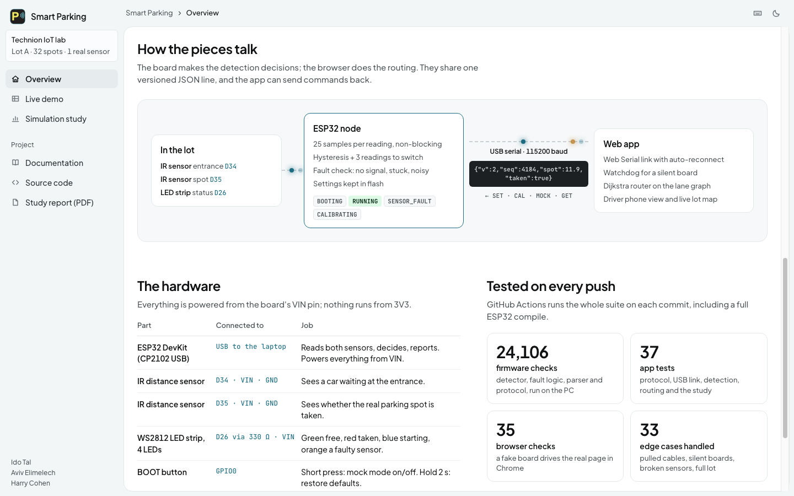
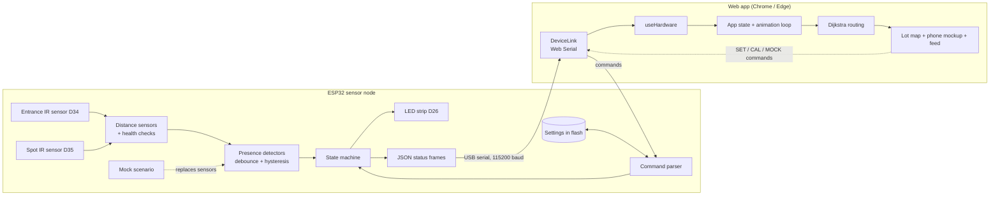

# Architecture

Smart Parking has three parts that talk over one simple protocol:



1. **The sensor node** (ESP32 firmware in `hardware/smart_parking/`): measures two IR sensors, decides
   "a car is at the entrance" and "the spot is taken" on the board itself, drives the LED strip, and
   reports everything as one JSON line per ~150 ms.
2. **The web app** (`src/`): reads those lines in the browser over USB (Web Serial), finds the nearest
   free spot with Dijkstra's shortest path, and shows the route on a live lot map and on a phone mockup.
3. **The simulation study** (`src/sim/`, `simulation/`): measures how much driving the routing saves.



## Where the decisions are made

| Decision | Made by | Why |
| --- | --- | --- |
| Is a car at the entrance? Is the spot taken? | **The ESP32** (`PresenceDetector`) | The LEDs must be right even when no PC is connected, so the board cannot depend on the app. |
| Is a sensor broken? | **The ESP32** (`SensorHealth`) | Only the board can see the raw ADC values. |
| Which spot is nearest? What is the route? | The web app (`src/lot/pathfinding.ts`) | It needs the whole lot map, including the simulated spots. |
| What do the thresholds mean (15 cm...)? | The board stores them; the app's sliders send them (`SET ...`) | One source of truth, kept in flash, survives a power cycle. |

With older firmware (distances only) the app falls back to deciding locally, so nothing breaks.

## Firmware: one class per job

All hardware access is concentrated in a few small classes; the logic classes never touch a pin.
The logic classes have no Arduino code at all, so they are unit-tested on a normal computer.

| File | Class / content | Touches hardware? |
| --- | --- | --- |
| `config.h` | every fixed setting (pins, timing, thresholds, WiFi switch) | no |
| `secrets.h.example` | WiFi name/password and OTA password template (`secrets.h` is git-ignored) | no |
| `ir_math.h` | raw ADC value to centimetres (lab formula) | no |
| `distance_sensor.h` | `IrDistanceSensor`: non-blocking averaging of 25 samples; `AnalogReader` interface | no (reads through the interface) |
| `hardware_io.h` | `PinAnalogReader`: the only `analogRead()` in the firmware | **yes** |
| `presence_detector.h` | `PresenceDetector`: debounce + hysteresis | no |
| `sensor_health.h` | `SensorHealth`: finds unplugged / shorted / noisy sensors | no |
| `mock_source.h` | `MockScenario`: generated car-arrives / parks / leaves data | no |
| `settings.h` | `Settings`, validation, calibration maths | no |
| `settings_store.h` | `SettingsStore`: saves settings in flash (`Preferences`) | **yes** |
| `command_parser.h` | `parseCommand()`: the text commands | no |
| `protocol.h` | formats the JSON lines | no |
| `state_machine.h` | `nextState()`: the only place that decides the operating mode | no |
| `button.h` | `Button`: debounce, short vs long press | no |
| `status_leds.h` | `StatusLeds`: the LED strip patterns | **yes** |
| `wifi_service.h` | `WifiService`: optional WiFi, status page, OTA (off by default) | **yes** |
| `node.h` | `SmartParkingNode`: owns the objects above and runs the loop | wires them together |
| `smart_parking.ino` | `setup()` / `loop()` only | - |

## Web app

| Path | Job |
| --- | --- |
| `src/hardware/deviceLink.ts` | `DeviceLink`: the only code that touches the serial port (connect, reconnect, unplug, watchdog, write) |
| `src/hardware/protocol.ts` | decodes the board's lines, builds the commands |
| `src/hardware/deviceModel.ts` | turns a frame into "what do we believe now", and stale detection |
| `src/hardware/useSerialSensors.ts` | React wrapper around `DeviceLink` |
| `src/hardware/useHardware.ts` | real board **or** emulator, same output: two booleans plus device info |
| `src/hardware/sensorLogic.ts` | debounce used for the emulator and old firmware |
| `src/lot/` | the lot model, Dijkstra/BFS routing, turn-by-turn directions (no React) |
| `src/config/` | all tunable numbers; remembered settings |
| `src/components/` | UI: lot map (canvas), phone, hardware panel, live sensor trace, session panel, reliability view |
| `src/pages/` | the Overview and Simulation study pages |
| `src/theme.ts` | light / dark theme: follows the system setting until the user picks one, remembered in the browser |
| `src/shortcuts.ts` | the keyboard shortcuts, listed once for the handlers and the help dialog |
| `src/Root.tsx` | the frame (sidebar, top bar) and the hash router: `#/`, `#/demo`, `#/simulation` |
| `src/App.tsx` | the live demo: state and the animation loop |

## A car arrives

```mermaid
sequenceDiagram
    participant Car as Car at the entrance
    participant ESP as ESP32
    participant Link as DeviceLink
    participant App as App
    Car->>ESP: IR sensor D34 reads < 15 cm
    ESP->>ESP: 3 readings in a row: car = true
    ESP->>Link: {"car":true,...}
    Link->>App: frame
    App->>App: "CAR DETECTED", Dijkstra finds the nearest free spot
    App-->>Car: phone shows turn-by-turn route, lot shows the car driving
    Car->>ESP: parks at the spot, D35 reads < 15 cm
    ESP->>ESP: spot taken = true, LEDs turn red
    ESP->>Link: {"taken":true,...}
    App->>App: car arrived; the real sensor moves to the next spot
```
