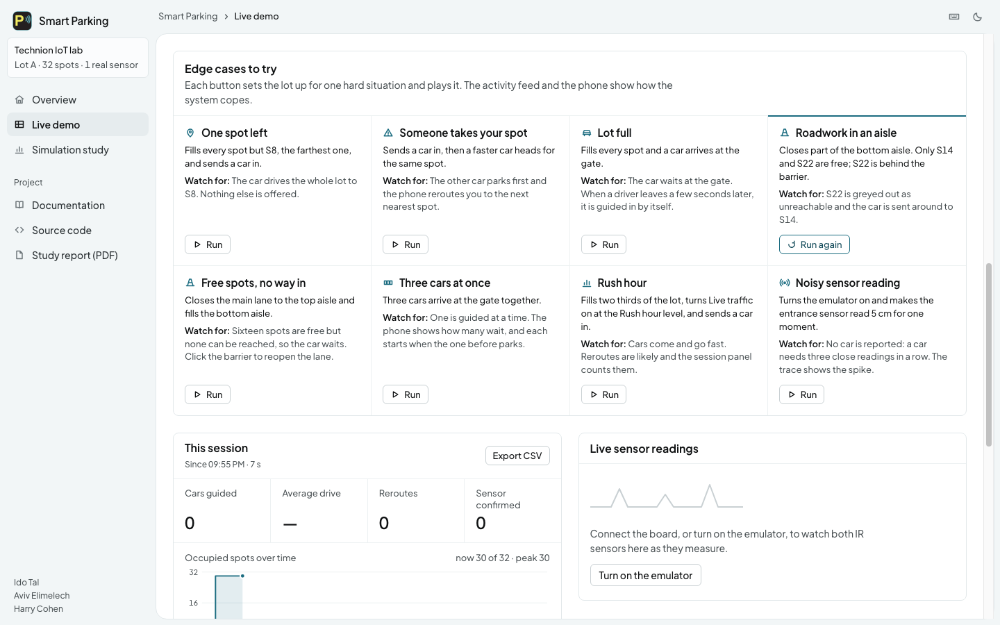

# Edge cases and how the system handles them

For every likely problem: what the **user sees** (indication), what the system **does about it**
(recovery), where in the code, and how it was **verified**. The live demo's **Reliability** section shows the
most important of these checks working in real time, and its **Edge cases to try** panel plays rows 27, 28, 34, 35,
37, 38 and 12 with one click each.

Verification key: **unit** = automated test of the logic, **node** = automated test of the whole firmware
node against a fake Arduino (`hardware/tests/test_node.cpp`), **browser** = automated test of the web app
against a simulated board in a real browser (`tests/e2e/`), **manual** = needs the real hardware, see
[docs/TESTING.md](TESTING.md).

## Connection (USB)

| # | Edge case | User indication | Recovery | Code | Verified |
| - | --- | --- | --- | --- | --- |
| 1 | Another program (e.g. Arduino IDE Serial Monitor) holds the port | Red message: "Could not open the port. Close the Arduino IDE Serial Monitor..." | Port is closed and opened once more automatically; the user closes the other program and presses Connect again | `deviceLink.ts` `open()` | unit |
| 2 | Browser has no Web Serial (Safari, Firefox) | Note: "USB connection needs Chrome or Edge" | The emulator and mock mode still work | `HardwarePanel.tsx` | manual |
| 3 | User closes the port picker | Nothing (no error) | Back to "Not connected" | `deviceLink.ts` `connect()` | unit |
| 4 | Cable pulled out while running | "Lost connection to the board (was it unplugged?)", entry in the activity feed, detection cleared | When the board is plugged in again the app reconnects by itself (the port was allowed before) | `deviceLink.ts` `onPortGone` / `onPortBack` | unit (unplug), manual (replug) |
| 5 | Board freezes or stops sending | "Board not responding" banner and a feed warning; **detection is paused** so an old "taken" never stays on screen | Resumes by itself when data returns | `deviceLink.ts` watchdog, `useHardware.ts` | unit, browser |
| 6 | Connected, but the board never sends anything (wrong sketch, wrong baud rate) | "Connected, but the board is not sending data. Check that the Smart Parking sketch is uploaded and the baud rate is 115200." | Fix and it starts flowing | `deviceLink.ts` `checkStale()` | unit |
| 7 | The ESP32 resets when the port opens and prints boot text | Nothing | Boot lines are ignored; reset lines are released after opening | `protocol.ts`, `deviceLink.ts` | unit |
| 8 | Half lines, garbage, or unknown fields on the line | Nothing | Anything that is not a valid message is dropped, nothing throws | `parseDeviceLine()` | unit |
| 9 | A board that never sends a newline | Nothing | The receive buffer is capped (4 kB) | `deviceLink.ts` | unit |
| 10 | Browser storage blocked or damaged | Nothing | The saved settings fall back to defaults, the app keeps working | `storedSettings.ts` | unit |

## Sensors

| # | Edge case | User indication | Recovery | Code | Verified |
| - | --- | --- | --- | --- | --- |
| 11 | A sensor wire falls off, is shorted, or the pin floats (noise) | LEDs blink orange; board state `SENSOR_FAULT`; the app marks the sensor **FAULT** and shows "A sensor looks broken..."; a feed warning | The broken sensor's readings are ignored (it can never report a car or a taken spot); when it works again for 5 readings the node returns to normal by itself | `sensor_health.h`, `node.h`, `deviceModel.ts` | unit, node, browser |
| 12 | One bad reading (a glitch) | Nothing | A fault needs 20 bad readings in a row; a car needs 3 | `SensorHealth`, `PresenceDetector` | unit |
| 13 | Something hovers right at the trigger distance | Nothing | 2 cm hysteresis plus 3-in-a-row, so no flicker | `presence_detector.h` | unit |
| 14 | Nothing in front of a sensor (out of range) | "80 cm" | Reported as exactly 80 cm (never a huge or negative number) | `ir_math.h` | unit |
| 15 | Wrong trigger distance for the setup | Sliders in the app, calibration button | Calibrate with the car in place (sets the distance automatically, saved in flash) | `settings.h`, `node.h` | unit, node, browser |

## Commands and settings

| # | Edge case | User indication | Recovery | Code | Verified |
| - | --- | --- | --- | --- | --- |
| 16 | Typo, words instead of a number, huge number, "nan" | `{"err":"value is not a number"}` (shown in the technician panel) | Command is ignored, the board keeps running | `command_parser.h` | unit, node |
| 17 | Setting out of range (e.g. `SET SPOT_CM 500`) | `{"err":"value out of range (5 to 60)"}`; the sliders cannot go outside 5-60 | Setting unchanged | `node.h`, `HardwarePanel.tsx` | node |
| 18 | A very long line or a flood of random bytes | `{"err":"line too long"}` | The line is dropped, the next command works | `node.h` `readSerial()` | node |
| 19 | Saved settings in flash are corrupted or missing | Nothing | Loaded values are checked; anything invalid becomes the default | `settings.h` `sanitize()` | unit |
| 20 | Calibrate with nothing in front of the sensor | "nothing in front of the sensor" | Refused; the old setting stays | `node.h` | node |
| 21 | Calibrate twice at once, in mock mode, or on a broken sensor | "already calibrating" / "turn mock mode off first" / "that sensor is faulty" | Refused | `node.h` | node |
| 22 | Power is cut | Nothing | Settings are kept in flash and loaded at the next start | `settings_store.h` | node |
| 23 | The slider and the board disagree about a threshold | Slider follows the board | The board is the source of truth; sliders send `SET`, and the app re-reads the board after a calibration or reset | `useHardware.ts`, `useSerialSensors.ts` | browser |
| 24 | `millis()` wraps after about 49.7 days | Nothing | All timers use unsigned subtraction | firmware | node |

## Modes and the parking logic

| # | Edge case | User indication | Recovery | Code | Verified |
| - | --- | --- | --- | --- | --- |
| 25 | No sensors connected (demo, or a sensor broke on demo day) | Violet last LED, "Mock mode" note | `MOCK ON`, the app toggle, or a short press of the BOOT button plays a generated car-arrives / parks / leaves story; the on-screen emulator is the browser-side equivalent | `mock_source.h`, `useHardware.ts` | unit, node, browser |
| 26 | No PC connected | LEDs still show open / taken | The board decides everything LED-related by itself | `node.h` | node |
| 27 | Car arrives and the lot is full | Feed: "Car at the entrance but the lot is full"; the phone button reads "Lot Full" | The car waits at the gate until a spot frees up (row 35) | `App.tsx` | browser |
| 28 | The spot a car is heading to gets taken | "Re-routing" notice on the phone | A new nearest spot is chosen | `App.tsx` | browser |
| 29 | A car parked at the real spot, then simulated traffic "leaves" | Nothing | Cars confirmed by the real sensor are never freed again | `App.tsx` `realParkedRef` | manual |
| 30 | The user clicks spots or drags the sensor tag while a car is navigating | "Spots are locked while your car is navigating" | Ignored | `App.tsx` | manual |
| 31 | Optional WiFi is on but the network is gone | Frames show `"wifi":"offline"`; the **first LED blinks cyan** | The node keeps measuring and driving the LEDs ("offline mode") and retries every 10 s | `wifi_service.h`, `status_leds.h` | compiled only, see [TESTING.md](TESTING.md) |
| 32 | The spot sensor reads "open" for a moment right after a real car parked (a hand moving the toy car, one noisy reading) | Nothing: the car stays on the map | The sensor moves on to the next spot at the same instant the car is confirmed, so a later "open" reading can only concern the new spot. A car confirmed by the real sensor is never freed by it again | `App.tsx` `advanceHardwareSpot` | browser (regression test that fails on the old code) |
| 33 | Dragging the real-sensor tag does not work (touch screen, small target, phone still showing "You've arrived") | The "Real sensor spot" picker in the Hardware panel, and "Locked while a car is on its way" when moving is not allowed | Pointer events work with mouse, touch and pen; the whole spot can be grabbed; the lot can be edited as soon as a trip has ended | `VirtualLot.tsx`, `HardwarePanel.tsx` | browser |
| 34 | A second app driver arrives while the first is still being guided | Feed: "Another app driver is guided to Spot S26. The spot is held for them."; the map marks the spot "held" | Both are guided at the same time, each to a different spot. A spot held for one app driver is never offered to another. Only when nothing can be offered does the car wait at the gate | `App.tsx` `guideAnotherDriver`, `lotForSearch` | browser |
| 35 | The lot is full when a car arrives | "Car at the entrance but the lot is full. It waits at the gate..."; the phone shows "Lot Full" and the line | The car waits and is guided by itself the moment a spot frees up | `App.tsx` | browser |
| 36 | More cars arrive than the gate can hold | "The line at the gate is full (5 cars)" | No more than 5 cars wait; further ones are turned away instead of piling up | `App.tsx` `MAX_QUEUE` | browser |
| 37 | A lane is closed (roadwork) | The lane is drawn with amber stripes and "CLOSED"; spots it cuts off are faded with "no way in", and the Free spots figure says how many are behind roadwork | Routes go around the closure; cut-off spots are never offered; simulated cars that would pass it turn back | `pathfinding.ts` `isWalkable`, `reachableSpotIds` | unit, browser |
| 38 | There are free spots, but a closed lane cuts all of them off | The phone says "No Way In" and "Reopen a lane on the map"; the car waits at the gate | Reopening the lane lets the waiting car drive in by itself | `App.tsx`, `PhoneApp.tsx` | unit, browser |
| 39 | The last spot is taken while the car is being detected | "The lot filled up before the car could be guided. It waits at the gate." | The car goes back in line instead of being lost | `App.tsx` search step | manual |
| 40 | The driving speed is changed in the middle of a drive | Nothing jumps: the remaining metres stay, only the time left changes | The elapsed drive is rescaled to the new speed | `App.tsx` `updateSettings` | browser |
| 41 | Saved demo settings are missing, damaged or unknown | Nothing | Each bad value falls back to its default on its own; the good ones are kept | `storedSettings.ts` `loadDemoSettings` | unit |
| 42 | The browser cannot speak, or refuses to before the page was clicked | The Spoken directions switch is greyed out with "This browser cannot speak" | The directions stay on screen; nothing throws | `speech.ts` | manual |
| 43 | The link to the app is lost (the tab is closed, the app disconnects, the laptop sleeps, or the cable is pulled while the board has its own power) | The **first LED blinks amber** within 3 s; the spot colour stays on the other LEDs; the app also says "Lost connection" | The board keeps deciding open / taken and driving the LEDs by itself; the warning stops the moment the app pings again | `link_monitor.h`, `status_leds.h`, `useHardware.ts` heartbeat | unit, node, browser (the app pings), manual (the LED) |
| 44 | Two app drivers would be sent to the same spot | Nothing: it cannot happen | The spot is held from the moment the app sends a driver until they are in it. Drivers without the app can still take it, which is when the phone reroutes (row 28) | `App.tsx` `heldSpots`, `src/sim/traffic.ts` | browser, simulation (0 conflicts in 9,442 rush-hour cars) |
| 45 | A rush: many cars arrive at once and everyone is sent to the first aisle | Nothing | Reservation, plus a small penalty for aisles other guided cars are heading into, spreads the rush: in a heavy rush into a 288-spot lot the wait from gate to spot falls from 261 s to 57 s and the longest gate queue from 19 to 3 cars | `src/sim/traffic.ts` (`balanced`) | simulation, see the Simulation study page |

## Not handled on purpose

Unlikely events (dropping the project, brown-outs, a car parked half in the spot) are out of scope.
Security and power saving are not goals of this project; there are no secrets in the repository
(`secrets.h` is git-ignored).
