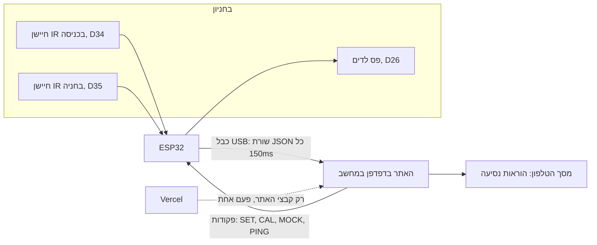

# איך המערכת עובדת

מדריך קצר שמסביר את כל המערכת מקצה לקצה: מה כל חלק עושה, איך המידע זז, ומה קורה כשמשהו נשבר.
בסוף יש שאלות ותשובות, כדי שכל אחד מחברי הצוות יוכל להסביר כל חלק.

## התמונה הכללית

יש שלושה חלקים:

1. **ה-ESP32 (הקושחה, `hardware/smart_parking/`)**
   - מודד את שני חיישני ה-IR כל כמה מילישניות.
   - מחליט בעצמו אם יש מכונית בכניסה ואם החניה תפוסה.
   - מדליק את הלדים: ירוק לפנוי, אדום לתפוס.
   - עושה את כל זה **גם בלי מחשב**. הלדים לא תלויים באתר.
2. **הקשר: כבל USB בלבד.**
   - הלוח שולח שורת JSON כ-6-7 פעמים בשנייה, ב-115200 baud. למשל:
     `{"v":2,"seq":812,"entrance":78.4,"spot":9.1,"car":false,"taken":true,"state":"RUNNING",...}`
   - האתר שולח ללוח פקודות טקסט:
     - `SET SPOT_CM 20` לשינוי מרחק ההפעלה
     - `CAL SPOT` לכיול
     - `MOCK ON` לנתונים מדומים
     - `PING` כל שנייה, כדי לומר "אני עדיין כאן"
3. **האתר (React, `src/`)**
   - קורא את הכבל ישירות מהדפדפן בעזרת **Web Serial** (Chrome / Edge).
   - מחשב את המסלול לחניה הפנויה הקרובה, ומציג הוראות נסיעה ומפה חיה.

**אין ענן ואין שרת.** Vercel הוא רק מקום שמגיש את קבצי האתר, כמו כל אתר סטטי.
- אחרי שהדף נטען, אף מדידה לא יוצאת מהמחשב.
- הבקשה היחידה לרשת בכל האפליקציה טוענת קובץ קבוע של תוצאות המחקר (`simulation-results.json`).
- את זה אפשר לראות בלשונית Network של Chrome.

**WiFi** הוא תוספת אופציונלית שנוספה אחרי ההערות (`wifi_service.h`):
- דף סטטוס קטן שהלוח עצמו מגיש, ועדכון קושחה באוויר.
- כבוי כברירת מחדל ונבדק רק בהידור.
- בגרסה שנבדקה לא היה WiFi בכלל.

## מה קורה כשמגיעה מכונית

1. מכונית עוצרת מול חיישן הכניסה. הלוח רואה 3 קריאות קרובות ברצף ושולח `"car":true`.
2. האתר מציג בטלפון "Car detected", מחפש את החניה הפנויה הקרובה ושומר אותה לנהג.
3. בטלפון מופיעות הוראות נסיעה ("סע ישר 6 מקומות, פנה ימינה...") והמרחק שנשאר, ובמפה רואים את המכונית נוסעת.
4. כשהמכונית נכנסת לחניה האמיתית, חיישן החניה מזהה אותה:
   - הלוח שולח `"taken":true` והלדים הופכים לאדומים.
   - האתר מאשר "Parked".
   - תג החיישן (HW) עובר לחניה הבאה.

## מה מחליט מה

| החלטה | איפה | למה שם |
| --- | --- | --- |
| יש מכונית / החניה תפוסה | **על הלוח** (`presence_detector.h`): 3 קריאות ברצף והיסטרזיס של 2 ס"מ | כדי שהלדים יעבדו גם בלי מחשב, ושרעש בחיישן לא יגרום להבהוב |
| חיישן מקולקל (חוט נפל, קצר, רעש) | **על הלוח** (`sensor_health.h`): 20 קריאות לא תקינות ברצף | חיישן שבור לא יכול לדווח על מכונית |
| מצב העבודה (עולה / עובד / מכייל / תקלה) | **על הלוח** (`state_machine.h`), [מכונת מצבים](STATE_MACHINE.md) | מקום אחד שמחליט |
| לאיזו חניה לשלוח | **באתר** (`src/lot/`) | האתר רואה את כל החניון |

## האלגוריתם

- **החניה הפנויה הקרובה:** חיפוש לרוחב (BFS) מהכניסה, על משבצות הנתיב (`pathfinding.ts`).
  - כל צעד עולה אותו דבר, ולכן BFS נותן בדיוק את מה שנותן דייקסטרה.
  - המחקר משתמש בדייקסטרה עם תור עדיפויות, ובודק אוטומטית ששניהם בוחרים אותה חניה.
- **בחניון גדול:** מבנה החניון לא משתנה. לכן מחשבים את המרחקים פעם אחת, ועץ מקטעים מוצא את החניה הפנויה הקרובה ב-`O(log n)` (`spotIndex.ts`).
- **מסלול לחניה ידועה** (ניתוב מחדש, החניה של החיישן): **A\*** עם יוריסטיקת מנהטן (`astar.ts`).
  - מחזיר מסלול באורך זהה ל-BFS, ובודק הרבה פחות משבצות.
- **שמירת חניה:** החניה שהאתר נתן לנהג לא מוצעת לאף נהג אחר שמשתמש באפליקציה, עד שהוא חונה.
  - נהג בלי האפליקציה לא יודע שהיא שמורה ועלול לתפוס אותה. אז האתר מנתב מחדש.
- **פיזור בעומס** (במחקר התנועה): קנס קטן על מעבר שכבר נוסעות אליו מכוניות מונחות, כדי שלא כולם ייתקעו במעבר הראשון.

## מה קורה כשמשהו נשבר

| מה קרה | מה רואים | מה המערכת עושה |
| --- | --- | --- |
| הכבל נותק | באתר: "Lost connection"; הזיהוי נעצר | כשמחברים שוב, האתר מתחבר לבד |
| הלוח הפסיק לשלוח (נתקע) | באתר: "Board not responding" | הזיהוי מושהה, כדי שמצב ישן לא יישאר על המסך |
| האתר הפסיק לדבר עם הלוח (לשונית נסגרה, ניתוק) | **הלד הראשון מהבהב בענבר** תוך 3 שניות | הלוח ממשיך לעבוד לבד; שאר הלדים מראים פנוי / תפוס |
| WiFi מופעל והרשת נפלה | **הלד הראשון מהבהב בתכלת** | הלוח ממשיך לעבוד ומנסה להתחבר כל 10 שניות |
| חיישן מקולקל | כל הלדים מהבהבים בכתום; באתר: FAULT | הקריאות שלו לא נחשבות; כשהוא חוזר לעבוד, הכל חוזר לבד |
| פקודה שגויה או ערך לא חוקי | תשובת שגיאה ברורה | הפקודה נדחית והלוח ממשיך |
| החניון מלא | בטלפון: "Lot Full" | המכונית מחכה בשער ונכנסת כשמתפנה מקום |
| החניה נתפסה בדרך | בטלפון: "rerouting" | ניתוב לחניה הקרובה הבאה |
| אין חיישנים בכלל (הדגמה) | הלד האחרון סגול | מצב mock: הלוח מייצר נתונים בעצמו |

הרשימה המלאה, 45 מקרים, כל אחד עם הקוד ואיך הוא נבדק: [EDGE_CASES.md](EDGE_CASES.md).

## שאלות שכדאי לדעת לענות עליהן

**ה-ESP שולח למחשב או לענן?**
למחשב, בכבל USB. הדפדפן קורא את הכבל ישירות. אין ענן ואין שרת, ו-Vercel רק מגיש את קבצי האתר.

**מה קורה אם האינטרנט נופל?**
כלום. המערכת לא משתמשת באינטרנט. אחרי שהדף נטען, הוא עובד גם בלי רשת. אם ה-WiFi האופציונלי מופעל, הלד הראשון מהבהב בתכלת והלוח ממשיך לעבוד.

**מה קורה אם הכבל נופל?**
- באתר מופיעה הודעה, וכשהכבל חוזר האתר מתחבר לבד.
- הלוח ממשיך להפעיל את הלדים לבד.
- אם הלוח נשאר דלוק (למשל, האתר נסגר), הלד הראשון מהבהב בענבר.

**למה ההחלטה "תפוס / פנוי" נעשית על הלוח ולא באתר?**
כדי שהלדים בחניון יעבדו גם בלי מחשב, וכדי שכל רעש יסונן קרוב לחיישן.

**איך מונעים הבהוב כשמשהו בדיוק על גבול המרחק?**
צריך 3 קריאות ברצף כדי לשנות מצב, ויש היסטרזיס של 2 ס"מ.

**איך יודעים שחיישן מקולקל?**
חוט שנפל או קצר לאדמה נותנים ערך של כמעט 0, חיישן תקוע על 3.3V נותן ערך מקסימלי, ורגל צפה נותנת פיזור גדול בין הדגימות. 20 קריאות כאלה ברצף (כ-3 שניות) מסמנות תקלה, ו-5 קריאות תקינות מחזירות למצב רגיל.

**למה BFS ולא A\*?**
- בשאלה "איזו חניה פנויה הכי קרובה" אין עדיין יעד, ול-A* צריך יעד בשביל היוריסטיקה.
- BFS ליניארי, ובחניון של 10,000 חניות הוא לוקח 3 מילישניות.
- כשיש יעד ידוע (ניתוב מחדש) משתמשים ב-A*.
- בחניון ענק משתמשים באינדקס שמחושב מראש, שעונה ב-`O(log n)`.

**האם שני נהגים יכולים להישלח לאותה חניה?**
לא, אם שניהם משתמשים באפליקציה: החניה שמורה. נהג בלי האפליקציה יכול לתפוס אותה, ואז האתר מנתב מחדש.

**האם כולם ייתקעו בכניסה?**
- ביום רגיל לא, כי מכוניות מגיעות בהפרש של דקות.
- בעומס כבד, בלי שמירה ובלי פיזור, כן: מדדנו פקק של 19 מכוניות בשער.
- עם שמירה ופיזור בין המעברים, הפקק יורד ל-3 מכוניות, והזמן מהשער לחניה יורד מ-261 ל-57 שניות.

**כמה זה חוסך?**
- 11.7% פחות נסיעה לחיפוש חניה בחניון שלנו.
- 33% בחניון של 288 חניות.
- 56% לעומת נהג שסתם מסתובב.
- 5,000 ימים מדומים, עם רווח סמך של 95%.
