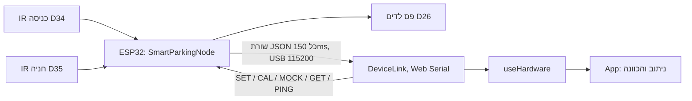

# מדריך למתכנת

למי שממשיך לפתח את הפרויקט: איך הקוד מאורגן, איך הלוח והאתר מדברים, איך מריצים ובודקים, ואיך מבצעים בבטחה את השינויים הנפוצים.
גרסה באנגלית: [PROGRAMMER_MANUAL.md](PROGRAMMER_MANUAL.md). למשתמשים: [USER_GUIDE.he.md](USER_GUIDE.he.md).

## 1. המערכת בפסקה אחת

- **ESP32** קורא שני חיישני מרחק אינפרא-אדום: כניסה ב-D34 וחניה ב-D35.
  - הוא מחליט בעצמו אם יש מכונית בכניסה ואם החניה תפוסה.
  - הוא מציג את מצב החניה ב**פס לדים WS2812** (D26): ירוק לפנוי, אדום לתפוס.
  - כל 150ms הוא שולח שורת JSON ב-**USB Serial**.
- **אתר React** קורא את השורה הזו בדפדפן בעזרת **Web Serial**, מנתב את המכונית לחניה הפנויה הקרובה, ומנחה אותה במסך טלפון ובמפה חיה.
- **אין שרת ואין ענן.** Vercel רק מגיש את הקבצים הסטטיים של האתר.
- **מחקר סימולציה** באותו מאגר מודד כמה נסיעה הניתוב חוסך.



עוד: [ARCHITECTURE.md](ARCHITECTURE.md) (קובץ-קובץ), [STATE_MACHINE.md](STATE_MACHINE.md) (כל מכונות המצבים).

## 2. מבנה המאגר

```
hardware/smart_parking/   קושחת ה-ESP32 (Arduino C++), מחלקה אחת לכל תפקיד
hardware/tests/           בדיקות קושחה שרצות על מחשב: מחלקות הלוגיקה, וכל הלוח מול Arduino מדומה
src/hardware/             הצד של האתר בחיבור ה-USB
src/lot/                  מודל החניון והניתוב: BFS, A*, האינדקס לחניה הקרובה, הוראות נסיעה
src/sim/                  מחקר הסימולציה (בלי React)
src/components/, pages/   ממשק המשתמש
src/config/               כל המספרים הניתנים לכוונון באתר
tests/                    בדיקות יחידה לאתר; tests/e2e/ בדיקות דפדפן מול לוח מדומה
simulation/               הרצה משורת הפקודה: המחקר, מחקר התנועה, מדידת הניתוב, דוח ה-PDF
docs/                     תיעוד
```

## 3. התקנה

**האתר.** צריך Node.js 18 ומעלה, ו-Chrome או Edge (בשביל Web Serial).

```bash
git clone https://github.com/Idosssss/SmartParking-1.git
cd SmartParking-1
npm install
npm run dev          # http://localhost:5173
```

**הקושחה.** צריך Arduino IDE 2 (או `arduino-cli`), את חבילת הלוחות **esp32** של Espressif, ואת ספריית **Adafruit NeoPixel**. פותחים את `hardware/smart_parking/smart_parking.ino`, בוחרים את הלוח **ESP32 Dev Module**, ולוחצים Upload.

```bash
arduino-cli compile --fqbn esp32:esp32:esp32 hardware/smart_parking
arduino-cli upload  --fqbn esp32:esp32:esp32 -p /dev/cu.usbserial-XXXX hardware/smart_parking
```

**WiFi (אופציונלי):** מעתיקים את `secrets.h.example` ל-`secrets.h` (הקובץ לא נכנס ל-git), ממלאים אותו, ומשנים ב-`config.h` את `ENABLE_WIFI` ל-1.

**פרסום.** כל push ל-`main` מעלה את האתר ל-Vercel אוטומטית. כל push גם מריץ CI ב-GitHub Actions:
- lint, בדיקת טיפוסים ובנייה
- כל בדיקות האתר והקושחה
- הידור הקושחה ל-ESP32

## 4. הקושחה

### הלולאה הראשית (`node.h`)

`SmartParkingNode::update()` רצה בכל סיבוב ואף פעם לא נחסמת:

1. **`readSerial`:** אוספת תווים של פקודה. שורה שלמה עוברת ל-`parseCommand()`. כל שורה גם מודיעה ל-`LinkMonitor` שהאפליקציה בחיים.
2. **`readButton`:** כפתור ה-BOOT. לחיצה קצרה מחליפה מצב mock, ולחיצה של 2 שניות מחזירה לברירת המחדל.
3. **`readSensors`:**
   - כל `IrDistanceSensor` ממצע 25 דגימות ADC בלי לחסום.
   - `SensorHealth` בודק את הערכים הגולמיים.
   - `PresenceDetector` מסנן את המרחק: 3 קריאות ברצף והיסטרזיס של 2 ס"מ.
   - חיישן תקול מאופס, ולכן אף פעם לא ידווח על מכונית.
4. **`finishCalibration`:** כשכיול (`CAL`) רץ.
5. **`nextState()`:** עולה, עובד, מכייל או תקלה בחיישן. זה המקום היחיד שמחליט על מצב העבודה.
6. **`StatusLeds::show()`:** התמונה בלדים לפי המצב, החניה, מצב mock והתרעת הקשר.
7. **`sendFrame`** כל 150ms, ואז **`WifiService::update`** (שלא עושה כלום אם ה-WiFi כבוי).

### גישה לחומרה רק דרך אובייקטים

`node.h` לא קורא בעצמו לשום פונקציית חומרה:
- הפינים, חיבור ה-USB, השעון והאתחול נמצאים ב-`hardware_io.h`: המחלקות `PinAnalogReader`, `PinButtonReader`, `UsbSerialPort` ו-`Esp32Board`.
- פס הלדים ב-`status_leds.h`, זיכרון ה-flash ב-`settings_store.h`, וה-WiFi ב-`wifi_service.h`.

כל שאר המחלקות הן C++ רגיל, ונבדקות ביחידות על מחשב.

### איפה נמצאות ההגדרות

| מה | קובץ |
| --- | --- |
| פינים, זמנים, ספים, גבולות לזיהוי תקלה, מתג WiFi | `config.h` |
| ערכים שהמשתמש משנה (ספים, בהירות), עם בדיקת תקינות ושמירה ב-flash | `settings.h`, `settings_store.h` |
| סיסמאות WiFi ו-OTA | `secrets.h` (לא ב-git; תבנית: `secrets.h.example`) |

## 5. הפרוטוקול על הכבל

אובייקט JSON אחד בכל שורה, ב-115200 baud, עם `\n` בסוף. הפרוטוקול מוגדר פעם אחת ב-`hardware/smart_parking/protocol.h` ומפוענח ב-`src/hardware/protocol.ts`.

**שורת מצב** (כל 150ms):

```json
{"v":2,"seq":812,"up":123456,"entrance":78.4,"spot":9.1,"car":false,"taken":true,
 "state":"RUNNING","mock":false,"faultE":"none","faultS":"none","wifi":"off"}
```

| שדה | משמעות |
| --- | --- |
| `v` | גרסת הפרוטוקול (2) |
| `seq`, `up` | מונה שורות, ומילישניות מאז ההפעלה |
| `entrance`, `spot` | מרחקים בס"מ (80 = אין כלום בטווח) |
| `car`, `taken` | ההחלטות של הלוח, אחרי סינון |
| `state` | `BOOTING`, `RUNNING`, `CALIBRATING` או `SENSOR_FAULT` |
| `mock` | הנתונים מיוצרים ולא נמדדים |
| `faultE`, `faultS` | `none`, `no_signal`, `saturated` או `noisy` |
| `wifi` | `off`, `online` או `offline` |

**תשובות:**
- ל-`GET`: `{"cfg":{"spot_cm":15.0,"entrance_cm":15.0,"brightness":40,"mock":false,"debug":false}}`
- אישור: `{"ack":"set","value":20.0}`
- שגיאה: `{"err":"value out of range (5 to 60)"}`
- עם `DEBUG ON` גם: `{"dbg":1,"rawE":..,"rawS":..,...}`

**פקודות** (לא משנה אם באותיות גדולות או קטנות):
- `HELP`, `GET`
- `SET SPOT_CM <5-60>`, `SET ENTRANCE_CM <5-60>`, `SET BRIGHTNESS <0-120>`
- `CAL SPOT`, `CAL ENTRANCE`
- `MOCK ON|OFF`, `DEBUG ON|OFF`
- `RESET`, `REBOOT`, `PING`

קלט שגוי תמיד מקבל `{"err":...}` ואף פעם לא מפיל את הלוח. שורה ארוכה מ-63 תווים נדחית.

## 6. האתר

### מהכבל למסך

1. **`deviceLink.ts`:** `DeviceLink` הוא הקוד היחיד שנוגע ב-Web Serial. הוא מטפל ב:
   - פתיחה, כולל המקרה שהפורט תפוס בתוכנה אחרת
   - קריאת שורות
   - ניתוק וחיבור מחדש של הכבל
   - שומר (watchdog): 2.5 שניות בלי נתונים = "לא מגיב"
2. **`useSerialSensors.ts`:** עטיפת React סביב `DeviceLink`.
3. **`useHardware.ts`:** ממשק אחד ללוח אמיתי **או** לאמולטור שעל המסך.
   - מחזיר `entranceDetected`, `spotOccupied` ופרטי הלוח.
   - שולח `PING` כל שנייה (`HEARTBEAT_MS`).
4. **`App.tsx`:**
   - מכונת המצבים של הנסיעה: idle ← detecting ← searching ← navigating ← arrived.
   - התור בשער, החניות השמורות, התנועה המדומה, סגירת נתיבים, והתרחישים של מקרי הקצה.
   - לולאת האנימציה קוראת הכל דרך refs, ולכן מופעלת פעם אחת בלבד.

### הניתוב (`src/lot/`)

| קובץ | שימוש |
| --- | --- |
| `pathfinding.ts` | BFS: החניה הפנויה הקרובה מהכניסה (או מהמכונית, בניתוב מחדש), מסלול לחניה נתונה, וחניות שאפשר להגיע אליהן מסביב לנתיבים סגורים |
| `astar.ts` | A* עם יוריסטיקת מנהטן, לחניה ידועה |
| `spotIndex.ts` | מרחקים שמחושבים פעם אחת ועץ מקטעים: החניה הפנויה הקרובה ב-`O(log n)`, לחניונים גדולים |
| `directions.ts` | הופך מסלול להוראות נסיעה, צעד אחר צעד |

### איפה נמצאים המספרים

- `src/config/constants.ts`: אנימציה, ספים, סימן החיים.
- `src/config/demoSettings.ts`: הגדרות ההדגמה, גודל התור, זמני מקרי הקצה.
- `src/config/storedSettings.ts`: מה שנשמר בדפדפן, עם בדיקת תקינות בטעינה.

## 7. הסימולציה

| קובץ | מה יש בו |
| --- | --- |
| `params.ts` | כל ההנחות |
| `engine.ts` | סימולציית הימים, עם השוואה מזווגת בין מדיניות |
| `drivers.ts` | האפליקציה, ושני מודלים של נהג בלי אפליקציה |
| `checks.ts` | 7 בדיקות עצמיות שרצות לפני כל מחקר |
| `experiments.ts` | התוצאה המרכזית וניתוחי הרגישות |
| `traffic.ts` | המודל שנייה-אחר-שנייה: נתיבים, כניסה לחניה ותור בשער |

```bash
npm run simulate           # המחקר הראשי -> public/simulation-results.json
npm run simulate:traffic   # מחקר התנועה -> public/traffic-study.json
npm run bench:routing      # מדידת BFS / A* / אינדקס -> public/routing-benchmark.json
npm run simulate:report    # דוח ה-PDF, משלושת הקבצים
```

## 8. בדיקות

| פקודה | מה היא מריצה |
| --- | --- |
| `npm run check` | lint, בדיקת טיפוסים ובנייה, 50 בדיקות לאתר, 24,115 בדיקות יחידה לקושחה ו-79 בדיקות של הלוח המלא |
| `npm run test:e2e` | 61 בדיקות דפדפן: Chrome בלי ממשק מפעיל את האתר האמיתי מול לוח מדומה (קודם מריצים `npm run dev`) |
| `sh hardware/tests/run.sh` | רק בדיקות הקושחה |

**הוספת בדיקה:**
- **אתר:** `test(...)` ב-`tests/*.test.ts`.
- **לוגיקת הקושחה:** `CHECK(...)` ב-`hardware/tests/test_firmware.cpp`.
- **הלוח המלא:** `hardware/tests/test_node.cpp`:
  - `world(entranceCm, spotCm)` קובע את החיישנים המדומים.
  - `run(n, ms)` מקדם את הזמן.
  - `g_leds[]` מראה את צבעי הלדים.
- **דפדפן:** `tests/e2e/*.e2e.mjs`, ושולטים בלוח המדומה דרך `window.__dev`.

רשימת הבדיקה הידנית לחומרה: [TESTING.md](TESTING.md).

## 9. שינויים נפוצים

| משימה | איפה |
| --- | --- |
| להעביר חיישן או את פס הלדים לפין אחר | `PIN_*` ב-`config.h` |
| לשנות את מרחק ההפעלה ברירת המחדל | `DEFAULT_*_CM` ב-`config.h` (המחוונים באתר ו-`SET` משנים אותו בזמן ריצה) |
| להוסיף פקודה | `CommandType` ו-`parseCommand()` ב-`command_parser.h`, `handleCommand()` ב-`node.h`, `deviceCommands` ב-`protocol.ts`, ובדיקה בכל אחד |
| להוסיף שדה לשורת המצב | `Frame` ו-`formatFrame()` ב-`protocol.h`, `parseDeviceLine()` ב-`protocol.ts`, ובדיקות הפרוטוקול |
| להוסיף חיישן חניה שני | `PinAnalogReader`, `IrDistanceSensor`, `SensorHealth` ו-`PresenceDetector` חדשים ב-`node.h`, שדה בשורת המצב, וחניית חומרה שנייה ב-`App.tsx` |
| לשנות את מבנה החניון | `generateLot.ts` (ההדגמה), `scaledLot.ts` (החניונים הגדולים של המחקר) |
| לשנות זמן או גבול באתר | `src/config/` |

## 10. תקלות בזמן פיתוח

| סימפטום | סיבה ופתרון |
| --- | --- |
| "Could not open the port" | תוכנה אחרת (ה-Serial Monitor של Arduino) מחזיקה את הפורט: סוגרים אותה |
| מחובר, אבל "not sending data" | הקוד הלא נכון על הלוח, או baud rate שגוי (חייב להיות 115200) |
| ההעלאה נכשלת | מחזיקים את כפתור ה-BOOT כשמופיע "Connecting...", או מורידים את מהירות ההעלאה |
| ירוק ואדום מתחלפים | משנים ב-`status_leds.h` את `NEO_GRB` ל-`NEO_RGB` |
| חיישן תקין מראה FAULT | ראו "Tuning the sensor-fault detection" ב-[HARDWARE.md](HARDWARE.md) |
| `npm run test:e2e` נכשל מיד | שרת הפיתוח לא רץ (`npm run dev`) |
