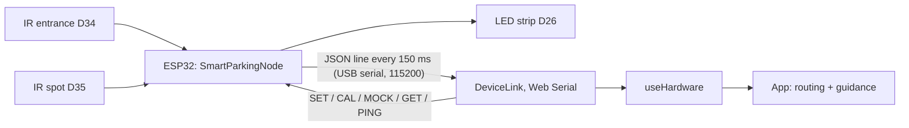

# Programmer's manual

For whoever builds on this project next. It explains how the code is organised, how the board and the
web app talk, how to run and test everything, and how to make the common changes safely.
Hebrew version: [PROGRAMMER_MANUAL.he.md](PROGRAMMER_MANUAL.he.md). For users: [USER_GUIDE.md](USER_GUIDE.md).

## 1. The system in one paragraph

An **ESP32** reads two infrared distance sensors (entrance D34, spot D35), decides by itself whether a car is at
the entrance and whether the spot is taken, and shows the spot on a **WS2812 LED strip** (D26): green free, red
taken. It sends one JSON line every 150 ms over **USB serial**. A **React web app** reads that line in the browser
with **Web Serial**, routes the arriving car to the nearest free spot, and guides it on a phone mock-up and a live
map. There is no server and no cloud: Vercel only hosts the page's static files. A **simulation study** in the same
repository measures how much driving the routing saves.



More: [ARCHITECTURE.md](ARCHITECTURE.md) (file by file), [STATE_MACHINE.md](STATE_MACHINE.md) (every state machine).

## 2. Repository layout

```
hardware/smart_parking/   ESP32 firmware (Arduino C++), one class per job
hardware/tests/           firmware tests that run on a PC (logic classes + the whole node on a fake Arduino)
src/hardware/             the web app's side of the USB link
src/lot/                  lot model and routing: BFS, A*, the nearest-spot index, directions
src/sim/                  the simulation study (no React)
src/components/, pages/   the user interface
src/config/               every tunable number of the app
tests/                    app unit tests; tests/e2e/ browser tests against a fake board
simulation/               command-line runners: study, traffic study, routing benchmark, PDF report
docs/                     documentation
```

## 3. Setting up

**Web app.** Node.js 18 or newer, and Chrome or Edge (Web Serial).

```bash
git clone https://github.com/Idosssss/SmartParking-1.git
cd SmartParking-1
npm install
npm run dev          # http://localhost:5173
```

**Firmware.** Arduino IDE 2 (or `arduino-cli`), the **esp32** board package (Espressif) and the
**Adafruit NeoPixel** library. Open `hardware/smart_parking/smart_parking.ino`, board **ESP32 Dev Module**, Upload.

```bash
arduino-cli compile --fqbn esp32:esp32:esp32 hardware/smart_parking
arduino-cli upload  --fqbn esp32:esp32:esp32 -p /dev/cu.usbserial-XXXX hardware/smart_parking
```

Optional WiFi: copy `secrets.h.example` to `secrets.h` (git-ignored), fill it in, set `ENABLE_WIFI 1` in `config.h`.

**Deploying.** Pushing to `main` deploys the site on Vercel automatically. Every push also runs CI (GitHub Actions):
lint, type-check and build, all app and firmware tests, and an ESP32 compile.

## 4. The firmware

### The main loop (`node.h`)

`SmartParkingNode::update()` runs every loop and never blocks:

1. **`readSerial`**: collect command characters; a full line goes to `parseCommand()`. Any line also tells
   `LinkMonitor` the app is alive.
2. **`readButton`**: BOOT button; short press toggles mock mode, 2 s restores the defaults.
3. **`readSensors`**: each `IrDistanceSensor` averages 25 ADC samples without blocking. `SensorHealth` checks the raw
   values, then `PresenceDetector` debounces the distance (3 readings in a row, 2 cm hysteresis). A faulty sensor is
   reset, so it can never report a car.
4. **`finishCalibration`**: when a `CAL` is running.
5. **`nextState()`**: booting / running / calibrating / sensor fault. This is the only place that decides the mode.
6. **`StatusLeds::show()`**: the LED picture for the state, the spot, mock mode and the link warning.
7. **`sendFrame`** every 150 ms, then **`WifiService::update`** (does nothing unless WiFi is on).

### Hardware only through objects

`node.h` makes no hardware call itself. Pins, the USB port, the clock and restart are in `hardware_io.h`
(`PinAnalogReader`, `PinButtonReader`, `UsbSerialPort`, `Esp32Board`). The LED strip is in `status_leds.h`, flash is
in `settings_store.h`, and WiFi in `wifi_service.h`. Every other class is plain C++ and is unit-tested on a PC.

### Settings and where they live

| What | File |
| --- | --- |
| Pins, timings, thresholds, fault limits, WiFi switch | `config.h` |
| Values the user can change (thresholds, brightness), validated and saved in flash | `settings.h`, `settings_store.h` |
| WiFi and OTA passwords | `secrets.h` (git-ignored; template `secrets.h.example`) |

## 5. The serial protocol

One JSON object per line, 115200 baud, `\n` at the end. Defined once in `hardware/smart_parking/protocol.h` and
parsed in `src/hardware/protocol.ts`.

**Status frame** (every 150 ms):

```json
{"v":2,"seq":812,"up":123456,"entrance":78.4,"spot":9.1,"car":false,"taken":true,
 "state":"RUNNING","mock":false,"faultE":"none","faultS":"none","wifi":"off"}
```

| Field | Meaning |
| --- | --- |
| `v` | protocol version (2) |
| `seq`, `up` | frame counter and milliseconds since boot |
| `entrance`, `spot` | distances in cm (80 = nothing in range) |
| `car`, `taken` | the board's debounced decisions |
| `state` | `BOOTING`, `RUNNING`, `CALIBRATING` or `SENSOR_FAULT` |
| `mock` | the data is generated, not measured |
| `faultE`, `faultS` | `none`, `no_signal`, `saturated` or `noisy` |
| `wifi` | `off`, `online` or `offline` |

**Replies:** `{"cfg":{"spot_cm":15.0,"entrance_cm":15.0,"brightness":40,"mock":false,"debug":false}}` to `GET`,
`{"ack":"set","value":20.0}`, `{"err":"value out of range (5 to 60)"}`, and with `DEBUG ON` also
`{"dbg":1,"rawE":..,"rawS":..,"stdE":..,"stdS":..,"vE":..,"vS":..}`.

**Commands** (case-insensitive): `HELP`, `GET`, `SET SPOT_CM <5-60>`, `SET ENTRANCE_CM <5-60>`,
`SET BRIGHTNESS <0-120>`, `CAL SPOT`, `CAL ENTRANCE`, `MOCK ON|OFF`, `DEBUG ON|OFF`, `RESET`, `REBOOT`, `PING`.
Bad input always gets an `{"err":...}` and never crashes the board. Lines longer than 63 characters are rejected.

## 6. The web app

### From the cable to the screen

1. **`deviceLink.ts`**: `DeviceLink` is the only code that touches Web Serial. It handles opening (and the
   busy-port case), reading lines, unplugging and replugging, and a watchdog: no data for 2.5 s means "not responding".
2. **`useSerialSensors.ts`**: the React wrapper around `DeviceLink`.
3. **`useHardware.ts`**: one interface for a real board **or** the on-screen emulator. It returns `entranceDetected`
   and `spotOccupied` and the device info. It also sends `PING` every second (`HEARTBEAT_MS`).
4. **`App.tsx`**: the trip state machine (idle → detecting → searching → navigating → arrived), the gate queue,
   held spots, simulated traffic, lane closures and the edge-case set-ups. Its animation loop reads everything
   through refs, so it is started only once.

### Routing (`src/lot/`)

| File | Use |
| --- | --- |
| `pathfinding.ts` | BFS: nearest free spot from the entrance (or from the car, for a reroute); a route to a given spot; spots reachable around closed lanes |
| `astar.ts` | A* with the Manhattan heuristic, to a known spot |
| `spotIndex.ts` | distances computed once + a segment tree: the nearest free spot in O(log n), for big lots |
| `directions.ts` | turns a path into turn-by-turn steps |

### Where the numbers live

`src/config/constants.ts` (animation, thresholds, heartbeat), `src/config/demoSettings.ts` (demo settings, queue
size, edge-case timings), `src/config/storedSettings.ts` (what is remembered in the browser, validated on load).

## 7. The simulation

`src/sim/params.ts` holds every assumption. `engine.ts` simulates days with paired policies, and `drivers.ts` holds
the app and the two "no app" drivers. `checks.ts` runs 7 self-checks before any study. `experiments.ts` runs the
headline and the sweeps, and `traffic.ts` is the second-by-second model of lanes, parking manoeuvres and the gate queue.

```bash
npm run simulate           # main study -> public/simulation-results.json
npm run simulate:traffic   # traffic study -> public/traffic-study.json
npm run bench:routing      # BFS / A* / index benchmark -> public/routing-benchmark.json
npm run simulate:report    # the PDF report, from those three files
```

## 8. Testing

| Command | What it runs |
| --- | --- |
| `npm run check` | lint, type-check and build, 50 app tests, 24,115 firmware unit checks and 79 whole-node checks |
| `npm run test:e2e` | 61 browser checks: headless Chrome drives the real page against a fake board (start `npm run dev` first) |
| `sh hardware/tests/run.sh` | only the firmware tests |

**Adding a test.**
- **App:** a `test(...)` in `tests/*.test.ts` (Node's built-in runner).
- **Firmware logic:** a `CHECK(...)` in `hardware/tests/test_firmware.cpp`.
- **Whole board:** `hardware/tests/test_node.cpp`, where `world(entranceCm, spotCm)` sets the fake sensors, `run(n, ms)` advances time, and `g_leds[]` shows the LED colours.
- **Browser:** `tests/e2e/*.e2e.mjs`, steering the fake board through `window.__dev`.

The manual hardware checklist is in [TESTING.md](TESTING.md).

## 9. Common changes

| Task | Where |
| --- | --- |
| Move a sensor or the LED strip to another pin | `PIN_*` in `config.h` |
| Change the default trigger distance | `DEFAULT_*_CM` in `config.h` (the app's sliders and `SET` change it at run time) |
| Add a command | `CommandType` and `parseCommand()` in `command_parser.h`, `handleCommand()` in `node.h`, `deviceCommands` in `protocol.ts`, plus a test in each |
| Add a field to the status line | `Frame` and `formatFrame()` in `protocol.h`, `parseDeviceLine()` in `protocol.ts`, and the protocol tests |
| Add a second spot sensor | a new `PinAnalogReader` + `IrDistanceSensor` + `SensorHealth` + `PresenceDetector` in `node.h`, a field in the frame, and a second hardware spot in `App.tsx` |
| Change the lot layout | `generateLot.ts` (the demo), `scaledLot.ts` (the study's larger lots) |
| Change a timing or a limit in the app | `src/config/` |

## 10. Troubleshooting while developing

| Symptom | Cause and fix |
| --- | --- |
| "Could not open the port" | another program has it (the Arduino Serial Monitor): close it |
| Connected, but "not sending data" | the wrong sketch, or the wrong baud rate (must be 115200) |
| Upload fails | hold the BOOT button when "Connecting..." appears, or lower the upload speed |
| Green and red swapped | change `NEO_GRB` to `NEO_RGB` in `status_leds.h` |
| A healthy sensor shows FAULT | see "Tuning the sensor-fault detection" in [HARDWARE.md](HARDWARE.md) |
| `npm run test:e2e` fails at once | the dev server is not running (`npm run dev`) |
