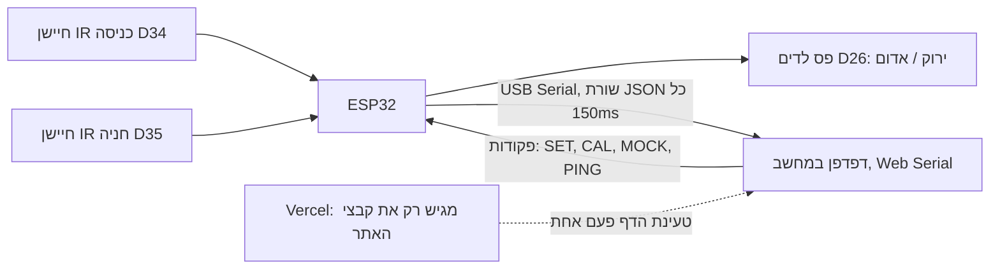

# תשובה להערות הבודקים, צוות 3ב'

המסמך עובר על ההערות אחת-אחת. בכל סעיף מופיעים שלושה חלקים:

1. **מה היה בגרסה שנבדקה.** הקישורים מובילים לקוד בדיוק כפי שהיה בקומיט האחרון לפני הבדיקה, `d879bf4` מ-19/10, או בקומיטים מוקדמים יותר.
2. **מה תיקנו בעקבות ההערות.** כל מה שנעשה אחרי ההערות נמצא בקומיטים מ-28/10 ואילך ([רשימת הקומיטים](https://github.com/Idosssss/SmartParking-1/commits/main)). לא שינינו את ההיסטוריה ולא ערבבנו בין הגרסאות.
3. **איך לבדוק בעצמכם.**

## תאריכים שאפשר לאמת

| קומיט | תאריך | מה נכנס |
| --- | --- | --- |
| [`c79578a`](https://github.com/Idosssss/SmartParking-1/commit/c79578a9693f7088b874c266556b556abe1d652f) | 22/09 | האתר, הסימולציה של החניון, תנועה חיה, ניתוב מחדש, חניון מלא |
| [`208ce25`](https://github.com/Idosssss/SmartParking-1/commit/208ce251c51edfd7cbd98357aab2c57367823b89) | 05/10 | חיבור ה-ESP32 והחיישנים לאתר (USB) |
| [`e877299`](https://github.com/Idosssss/SmartParking-1/commit/e87729994f3986f430d583ef11bef27f4c07dfb9) | 05/10 | פס הלדים (NeoPixel על D26): ירוק פנוי, אדום תפוס |
| [`00c99ce`](https://github.com/Idosssss/SmartParking-1/commit/00c99ce82416165e812fa615c9a634304371351d) | 05/10 | מכונית שהחיישן האמיתי אישר לא משתחררת יותר |
| [`d879bf4`](https://github.com/Idosssss/SmartParking-1/commit/d879bf468b7472130ed04705b2759f89f5258902) | 19/10 | מחקר הסימולציה ודוח ה-PDF (הגרסה האחרונה לפני הבדיקה) |

בנוסף ל-GitHub, גם יומן הפריסות של Vercel רושם בשרת של Vercel מתי כל גרסה עלתה לאוויר, ואי אפשר לשנות אותו בדיעבד. נשמח לשלוח צילום מסך שלו.

---

## מה הפרויקט שנבדק כבר כלל

כל הסעיפים כאן מהגרסה מ-19/10 ([`d879bf4`](https://github.com/Idosssss/SmartParking-1/commit/d879bf468b7472130ed04705b2759f89f5258902)):

- **שרשרת IoT מלאה:**
  - שני חיישני IR ו-ESP32 שמסנן רעש בעצמו (3 קריאות ברצף והיסטרזיס).
  - פס לדים שעובד גם בלי מחשב.
  - חיבור USB ישירות לדפדפן (Web Serial).
  - אפליקציית טלפון עם הוראות נסיעה ומפה חיה.
  - אתר שפורסם ב-Vercel.
- **מחקר סימולציה:**
  - 5,000 ימים מדומים, עם השוואה מזווגת: אותן מכוניות בדיוק, עם האפליקציה ובלעדיה.
  - תוצאה מרכזית: 11.7% פחות נסיעה, רווח סמך של 95% בין 11.6% ל-11.8%.
  - שני מודלים של נהג בלי האפליקציה.
  - 7 ניתוחי רגישות: שיעור השימוש באפליקציה, טווח הראייה, סוג הנהג, הביקוש, זמן החניה, גודל המשבצת, וגודל החניון עד 288 חניות (שם החיסכון מגיע ל-33%).
- **7 בדיקות עצמיות** שחייבות לעבור לפני כל הרצה ([`checks.ts`](https://github.com/Idosssss/SmartParking-1/blob/d879bf468b7472130ed04705b2759f89f5258902/src/sim/checks.ts)):
  - דייקסטרה זהה לנתב של האפליקציה.
  - המרחקים זהים ל-Floyd-Warshall.
  - מסלול האפליקציה אף פעם לא ארוך מחיפוש.
  - אף מכונית לא נעלמת.
  - אותו seed נותן אותם מספרים.
- **דוח של 13 עמודים** ב-9 פרקים, הדגמה אינטראקטיבית צעד-אחר-צעד, וסימולציה שרצה בדפדפן עם פרמטרים שהמשתמש בוחר.

---

## 1. בדיקת חומרה: "לא חיברו את ה-LED למערכת ובדקו שהוא עובד"

**מה היה.**
- פס הלדים היה ממומש בקוד מ-05/10, כלומר לפני הבדיקה:
  - [הגדרת D26 כחיבור הלדים](https://github.com/Idosssss/SmartParking-1/blob/e87729994f3986f430d583ef11bef27f4c07dfb9/hardware/smart_parking/smart_parking.ino#L5)
  - [ספריית NeoPixel](https://github.com/Idosssss/SmartParking-1/blob/e87729994f3986f430d583ef11bef27f4c07dfb9/hardware/smart_parking/smart_parking.ino#L19)
  - [הקוד שצובע ירוק / אדום](https://github.com/Idosssss/SmartParking-1/blob/e87729994f3986f430d583ef11bef27f4c07dfb9/hardware/smart_parking/smart_parking.ino#L87-L90)
- ה-README שהוגש תיעד את חיווט הלדים בפירוט: D26 דרך נגד של 330 אוהם, הזנה מ-VIN, באיזה קצה של הפס מתחברים, ומה עושים אם ירוק ואדום מתחלפים ([README L86-91]({B}/README.md#L86-L91)). את הפרטים האלה לומדים מעבודה עם הרכיב עצמו.
- הצגנו את הלדים עובדים בשיעור.
- בבדיקת החומרה עצמה הלדים לא היו מחוברים פיזית. לא הבנו שבבדיקה הזו צריך להציג את כל המעגל המחובר, כולל הלדים, וחשבנו שההצגה בשיעור מספיקה. זו טעות שלנו.

**מה עשינו.**
- חיברנו ובדקנו את הלדים על הלוח, ומצורף סרטון.
- הוספנו לדים לתקשורת: אם האפליקציה מפסיקה לדבר עם הלוח, הלד הראשון מהבהב בענבר תוך 3 שניות, ושאר הלדים ממשיכים להראות את מצב החניה. ראו סעיף 2.

**בדיקה.** [רשימת הבדיקות לחומרה](TESTING.md#what-is-not-covered-by-automation-and-how-to-check-it) מפרטת כל צבע ומתי הוא אמור להופיע.

---

## 2. שלב 2: איך עובר המידע, ומה קורה כשהתקשורת נופלת

### ה-ESP32 לא מדבר עם ענן. הוא מדבר עם המחשב בכבל USB.



- **ה-ESP32** מודד את שני החיישנים, מחליט בעצמו אם יש מכונית בכניסה ואם החניה תפוסה, ומדליק את הלדים. הוא עושה את כל זה גם בלי מחשב.
- **המידע עובר רק בכבל ה-USB** (Serial ב-115200), שורת JSON כל 150 מילישניות. הדפדפן קורא את הכבל ישירות דרך Web Serial, בלי שרת באמצע.
- **Vercel רק מגיש את קבצי האתר**, כמו כל אתר סטטי. אחרי שהדף נטען, אף מדידה לא יוצאת מהמחשב.
  - אין באפליקציה קוד שרת, אין API ואין WebSocket.
  - הבקשה היחידה לרשת בכל האפליקציה טוענת קובץ תוצאות קבוע של מחקר הסימולציה: [בגרסה שנבדקה](https://github.com/Idosssss/SmartParking-1/blob/d879bf468b7472130ed04705b2759f89f5258902/src/pages/SimulationPage.tsx#L48).
  - אפשר לראות את זה בעצמכם: בלשונית Network של Chrome לא מופיעה אף בקשה בזמן שהלוח שולח נתונים. מצורף סרטון.
- **כך גם היה כתוב בחומר שהוגש:**
  - הכותרת של קוד הלוח: "The board streams one JSON line per sample over USB serial... The web app reads these lines" ([sketch L7-11]({B}/hardware/smart_parking/smart_parking.ino#L7-L11)).
  - ה-README: "streams ... over USB serial at 115200 baud", ו-Chrome/Edge נדרשים בגלל Web Serial ([README L116-120]({B}/README.md#L116-L120)).
- **מקור אפשרי לבלבול, ואנחנו לוקחים עליו אחריות:** בסוף ה-README נשאר סעיף ישן מהגרסה הראשונה של הפרויקט, שהייתה סימולציה בלבד ("Where this is headed"). הוא תיאר תוכנית עתידית לחבר את החומרה "over MQTT/HTTP" ([README L184-190]({B}/README.md#L184-L190)). המימוש בפועל היה USB בלבד, כמו שכתוב בסעיף החומרה ובקוד הלוח. הסעיף הישן הוסר.
- **בגרסה שנבדקה לא היה WiFi בכלל.** אפשר לראות שאין בקוד הלוח של [`d879bf4`](https://github.com/Idosssss/SmartParking-1/blob/d879bf468b7472130ed04705b2759f89f5258902/hardware/smart_parking/smart_parking.ino) שום קוד רשת.
  - אחרי ההערות הוספנו WiFi כאפשרות: דף סטטוס קטן שהלוח עצמו מגיש, ועדכון קושחה באוויר. גם זה לא ענן.
  - האפשרות כבויה כברירת מחדל ונבדקה רק בהידור, וכך כתוב גם [בתיעוד](TESTING.md).

**הסבר מלא בעברית:** [איך המערכת עובדת](HOW_IT_WORKS.he.md).

לגבי הבדיקה עצמה: הבנו את שלב 2 כמפגש משוב על ההצגה, וחשבנו שיהיה מפגש שלישי חי שבו נציג את העבודה המלאה. לכן לא הגענו מוכנים להסבר מעמיק. אנחנו מבקשים להזדמן להסביר את המערכת שוב, בכל פורמט שנוח לכם.

### "אין התמודדות חומרתית (LED) לכך שהאינטרנט מתנתק"

**מה היה.**
- המערכת לא תלויה באינטרנט, ולכן נפילת אינטרנט לא משפיעה עליה.
- **החומרה כן טיפלה בניתוק, כבר בגרסה שנבדקה:** הלוח ממשיך לזהות ולהדליק את הלדים גם כשאין קשר עם האפליקציה. זה היה עיקרון תכנון מוצהר: "The LEDs work on their own, so the spot shows OPEN / TAKEN even when the board is not connected to the app" ([sketch L10-11]({B}/hardware/smart_parking/smart_parking.ino#L10-L11), [README L88-89]({B}/README.md#L88-L89)).
- הקשר שכן יכול ליפול הוא ה-USB, והאפליקציה טיפלה בו כבר בגרסה שנבדקה:
  - [הודעת "Lost connection to the board"](https://github.com/Idosssss/SmartParking-1/blob/d879bf468b7472130ed04705b2759f89f5258902/src/hardware/useSerialSensors.ts#L63)
  - [הודעה כשהפורט תפוס בתוכנה אחרת](https://github.com/Idosssss/SmartParking-1/blob/d879bf468b7472130ed04705b2759f89f5258902/src/hardware/useSerialSensors.ts#L32)
  - [רישום ביומן האירועים](https://github.com/Idosssss/SmartParking-1/blob/d879bf468b7472130ed04705b2759f89f5258902/src/App.tsx#L285)
- מה שבאמת היה חסר הוא **נורת אזהרה** על הלוח, שמראה שהקשר נפל. כאן ההערה נכונה.

**מה עשינו.**
- **האפליקציה שולחת `PING` כל שנייה.**
- **הלוח עוקב אחרי הקשר** ב-[`link_monitor.h`](../hardware/smart_parking/link_monitor.h). אחרי 3 שניות בלי סימן חיים, הלד הראשון מהבהב בענבר. כך זה עובד:
  - שאר הלדים ממשיכים להראות פנוי או תפוס, והלוח ממשיך להחליט לבד.
  - ההבהוב נעצר ברגע שהאפליקציה חוזרת.
  - לוח שאף פעם לא חובר למחשב לא מתריע, כי עבודה עצמאית היא מצב תקין.
  - אם ה-WiFi מופעל והרשת נופלת, הלד הראשון מהבהב בתכלת.
- **בדיקות:**
  - [בדיקות יחידה](../hardware/tests/test_firmware.cpp) ובדיקה של הלוח המלא מול Arduino מדומה ([`test_link_lost`](../hardware/tests/test_node.cpp)) בודקות את צבע כל לד.
  - בדיקה בדפדפן מוודאת שהאפליקציה אכן שולחת את ה-PING.
  - הקושחה עוברת הידור ל-ESP32 ב-CI.
- **מקרי קצה** 43 ו-31 ב-[EDGE_CASES.md](EDGE_CASES.md).

---

## 3. שלב 3: הסימולציה והאלגוריתם

### "כמה נהגים עלולים לקבל הכוונה לאותו מקום? לא ברור מדוע שהמערכת תאפשר כזה דבר"

**גם בגרסה שנבדקה המערכת לא אפשרה את זה.** האפליקציה אף פעם לא שלחה שני נהגים שלה לאותה חניה:

- **בהדגמה החיה האפליקציה הנחתה נהג אחד בכל פעם.** בזמן שנהג היה בדרך, הגעה נוספת לא קיבלה הכוונה ([App.tsx L186](https://github.com/Idosssss/SmartParking-1/blob/d879bf468b7472130ed04705b2759f89f5258902/src/App.tsx#L186)).
- **"Live traffic" הוא שאר התנועה בחניון**, כלומר נהגים שהאפליקציה לא מנחה. במקרא שלהם כתוב "Other traffic" ([L565](https://github.com/Idosssss/SmartParking-1/blob/d879bf468b7472130ed04705b2759f89f5258902/src/App.tsx#L565)).
  - הם בוחרים רק מבין החניות הפנויות ([L332](https://github.com/Idosssss/SmartParking-1/blob/d879bf468b7472130ed04705b2759f89f5258902/src/App.tsx#L332)).
  - לפעמים הם נוסעים בכוונה לחניה של הנהג שלנו ([L341-342](https://github.com/Idosssss/SmartParking-1/blob/d879bf468b7472130ed04705b2759f89f5258902/src/App.tsx#L341-L342)). כך מודגם המקרה האמיתי שאפליקציה לא יכולה למנוע: נהג בלי האפליקציה תופס את החניה.
  - במקרה כזה הטלפון מנתב מחדש לחניה הקרובה הבאה ([L395](https://github.com/Idosssss/SmartParking-1/blob/d879bf468b7472130ed04705b2759f89f5258902/src/App.tsx#L395)).
- **בסימולציה, החניה מסומנת תפוסה ברגע שהאפליקציה מקצה אותה** ([engine.ts L174](https://github.com/Idosssss/SmartParking-1/blob/d879bf468b7472130ed04705b2759f89f5258902/src/sim/engine.ts#L174)), ולכן אף חניה לא הוצעה לשני נהגים. זו שמירת חניה בפועל.

**מה הוספנו בעקבות ההערה:**
- **הכוונה של כמה נהגים במקביל**, במקום נהג אחד בכל פעם, עם שמירת חניה מפורשת: החניה מסומנת "held" במפה ולא מוצעת לאף נהג אחר של האפליקציה ([`heldSpots`](../src/App.tsx)).
- **בדיקה בדפדפן** מוודאת ששלושה נהגים שמגיעים יחד מקבלים שלוש חניות שונות.
- **מדידה בסימולציית התנועה החדשה:** בעומס כבד (288 חניות, 8 מכוניות בדקה), בלי שמירה, נהגים נשלחו 1,835 פעמים לחניה שמישהו אחר תפס, לכל 1,000 מכוניות. עם שמירה: 0 פעמים, מתוך 9,442 מכוניות. כלומר הבחירה שלנו לשמור את החניה היא הנכונה, וזה מוכח במספרים.

### "הסימולציה לא לקחה בחשבון זמן חניה... צוואר בקבוק בכניסה"

**משך החניה כן היה במודל, ובדוח שהוגש:**
- כל מכונית חונה זמן אקראי, לוג-נורמלי עם ממוצע של 90 דקות ([`params.ts`](https://github.com/Idosssss/SmartParking-1/blob/d879bf468b7472130ed04705b2759f89f5258902/src/sim/params.ts#L41)).
- בדוח יש טבלת הנחות עם שורת "Time parked" ([L211](https://github.com/Idosssss/SmartParking-1/blob/d879bf468b7472130ed04705b2759f89f5258902/simulation/build-report.ts#L211)), וגרף שלם של משכי החניה ([L310](https://github.com/Idosssss/SmartParking-1/blob/d879bf468b7472130ed04705b2759f89f5258902/simulation/build-report.ts#L310)).
- **יותר מזה: המחקר בדק בדיוק את ההשפעה של זמן החניה.** הרצנו את כל הסימולציה מחדש עם זמן חניה ממוצע של 30, 60, 90, 150 ו-240 דקות ([`experiments.ts` L168-173](https://github.com/Idosssss/SmartParking-1/blob/d879bf468b7472130ed04705b2759f89f5258902/src/sim/experiments.ts#L168-L173)). החיסכון של האפליקציה עולה עם זמן החניה: 4.9%, 7.8%, 11.6%, 18.8% ו-21.5%, כי חניון שמכוניות נשארות בו יותר זמן מלא יותר וקשה יותר למצוא בו מקום.

**גם הגודש בנתיבים הופיע בדוח, כמגבלה מוצהרת.** בפרק 9, "Limits of this study", כתבנו: "Searches do not overlap... The model ignores congestion in the aisles" ([L332](https://github.com/Idosssss/SmartParking-1/blob/d879bf468b7472130ed04705b2759f89f5258902/simulation/build-report.ts#L332)). כלומר זיהינו את הנקודה הזו כבר אז. הערכנו שהשמטה שלה מחמירה רק עם הנהגים בלי האפליקציה, והבדיקה החדשה מראה שזה נכון ביום רגיל אבל לא בעומס כבד (ראו למטה).

**על צוואר הבקבוק אתם צודקים, ובדקנו אותו.** כתבנו סימולציה חדשה, שנייה-אחר-שנייה ([`src/sim/traffic.ts`](../src/sim/traffic.ts)):
- כל משבצת בנתיב מחזיקה מכונית אחת לכל כיוון.
- כניסה לחניה לוקחת 20 שניות ויציאה ממנה 15 שניות, ובזמן הזה המכונית חוסמת את הנתיב.
- מי שמגיע כשהכניסה תפוסה מחכה בתור בשער.

השווינו ארבע מדיניות. כל אחת קיבלה בדיוק אותן מכוניות, באותן שעות הגעה:

| מצב | מדיניות | מהשער עד החניה, ממוצע | 95% מהמכוניות תוך | התור הארוך בשער |
| --- | --- | ---: | ---: | ---: |
| יום רגיל בחניון שלנו | החניה הקרובה (הגרסה שנבדקה) | 33.1 ש' | 45.8 ש' | 1.1 |
| | שמירה + פיזור בין המעברים | 32.2 ש' | 41.4 ש' | 1.1 |
| עומס כבד, 288 חניות | החניה הקרובה (הגרסה שנבדקה) | **261 ש'** | 677 ש' | **19.4** |
| | שמירת חניה | 64.7 ש' | 92.8 ש' | 3.6 |
| | שמירה + פיזור בין המעברים | **57.5 ש'** | 82.1 ש' | **2.9** |
| | בלי אפליקציה | 128.6 ש' | 285.5 ש' | 7.3 |

**המסקנות:**
- ביום רגיל אין צוואר בקבוק, כי המכוניות מגיעות בהפרש של דקות.
- בעומס, שליחת כולם לחניה הקרובה בלי שמירה אכן פוקקת את המעבר הראשון. כאן ההערה שלכם נכונה, והמדידה מאשרת אותה.
- הפתרון: שמירת חניה, ועוד קנס קטן על מעבר שכבר נוסעות אליו מכוניות מונחות (3 משבצות לכל מכונית). זה מפזר את העומס ומקצר את הזמן מהשער לחניה פי 4.5.
- הדרך מוצגת גם ב[עמוד מחקר הסימולציה](https://technionparking.vercel.app/#/simulation), וכל הטבלאות ב-[`public/traffic-study.json`](../public/traffic-study.json).
- בעומס הכבד ביותר בלי שמירה, המודל נאלץ 303 פעמים לשחרר מכונית שעמדה דקה שלמה בלי לזוז. כלומר הפקק במציאות היה גרוע אפילו יותר מהטבלה, וכתבנו את זה בעמוד.

### "BFS אינו סקאלאבילי... A* עם יוריסטיקת מרחק מנהטן"

**מימשנו A* כפי שהמלצתם, עם יוריסטיקת מנהטן,** ב-[`src/lot/astar.ts`](../src/lot/astar.ts):
- היוריסטיקה היא מרחק מנהטן פחות 1, כי המכונית עוצרת בנתיב שליד החניה. היא קבילה ועקבית, ולכן A* מחזיר מסלול קצר ביותר.
- בדיקה אוטומטית מוודאת שהמסלול באורך זהה ל-BFS לכל חניה, גם עם נתיבים סגורים.

**מדדנו את שלוש הגישות** על חניונים באותו מבנה, מ-32 עד 10,368 חניות, כש-85% מהחניות תפוסות ([`npm run bench:routing`](../simulation/bench-routing.ts)):

| חניות | החניה הקרובה, BFS לכל מכונית | החניה הקרובה, אינדקס | מסלול לחניה ידועה, BFS | מסלול לחניה ידועה, A* | משבצות שנבדקו BFS / A* |
| ---: | ---: | ---: | ---: | ---: | ---: |
| 32 | 0.04 ms | 0.17 µs | 0.013 ms | 0.022 ms | 32 / 11 |
| 1,152 | 0.31 ms | 0.13 µs | 0.23 ms | 0.023 ms | 672 / 87 |
| 10,368 | 2.9 ms | 0.17 µs | 2.1 ms | 0.14 ms | 5,472 / 216 |

**מה זה אומר:**
- BFS אכן גדל עם גודל החניון. הוא ליניארי, `O(V+E)`, ולכן גם ב-10,000 חניות הוא לוקח 3 מילישניות למכונית.
- **A\* הוא הכלי הנכון כשיש יעד ידוע:** ניתוב מחדש, חניה שמורה, או החניה של החיישן האמיתי. בחניון הגדול הוא בודק 4% מהמשבצות ומהיר פי 15.
- **בשאלה "איזו חניה פנויה הכי קרובה?" עדיין אין יעד,** ולכן ל-A* אין יוריסטיקה להתכוונן אליה.
  - מבנה החניון לא משתנה כשמכוניות באות והולכות. לכן חישבנו את המרחקים פעם אחת, ועץ מקטעים (segment tree) מוצא את החניה הפנויה הקרובה ב-`O(log n)` ([`spotIndex.ts`](../src/lot/spotIndex.ts)).
  - בדיקה אוטומטית מוודאת שהאינדקס תמיד בוחר את אותה חניה כמו ה-BFS, לאורך אלפי שינויים אקראיים.
- **כבר בגרסה שנבדקה:**
  - המחקר השתמש בדייקסטרה עם תור עדיפויות, ובדק אוטומטית ב-1,920 מצבי חניון אקראיים שהיא בוחרת אותה חניה כמו הנתב של האפליקציה ([`checks.ts`](https://github.com/Idosssss/SmartParking-1/blob/d879bf468b7472130ed04705b2759f89f5258902/src/sim/checks.ts#L37)).
  - פרק 3 בדוח הסביר את האלגוריתם בפסאודו-קוד, ולמה BFS שווה לדייקסטרה כשכל צעד עולה אותו דבר.
  - המחקר בדק חניונים בגדלים שונים, מ-32 עד 288 חניות ([`experiments.ts`](https://github.com/Idosssss/SmartParking-1/blob/d879bf468b7472130ed04705b2759f89f5258902/src/sim/experiments.ts#L182-L189)).

### "תיעוד ברמה נמוכה"

**מה היה.** בגרסה שנבדקה היו:
- README של 190 שורות: התקנה, מבנה הפרויקט, חיווט מלא של החיישנים והלדים, הוראות העלאה וחיבור, וסיכום המחקר.
- דוח מחקר של 13 עמודים ב-9 פרקים: המודל, האלגוריתם עם פסאודו-קוד, שיטת הבדיקה, התוצאות עם רווחי סמך, והמגבלות.
- הערות מפורטות בקוד, למשל בכותרת של קוד הלוח.

מה שבאמת היה חסר: מסמך ארכיטקטורה, מסמך מקרי קצה ומדריך בעברית. את אלה הוספנו.

**מה עשינו.** הוספנו:
- מדריך למשתמש בעברית ובאנגלית
- [ארכיטקטורה](ARCHITECTURE.md) עם קובץ-קובץ, ו[מכונת מצבים](STATE_MACHINE.md)
- [חומרה](HARDWARE.md): חיווט, כיול, צריכת חשמל
- [45 מקרי קצה](EDGE_CASES.md): לכל אחד מה המשתמש רואה, איך המערכת מתאוששת, ואיך זה נבדק
- [בדיקות](TESTING.md), כולל רשימת בדיקה ידנית לחומרה
- המסמך הזה, ו[הסבר בעברית על איך המערכת עובדת](HOW_IT_WORKS.he.md)

---

## 4. מקרי קצה שהיו כבר לפני הבדיקה

כל הקישורים לגרסה מ-19/10 (`d879bf4`). רוב השורות היו כבר בגרסה מ-22/09.

| מקרה | מה המערכת עושה | קוד |
| --- | --- | --- |
| תנועה חיה: נהגים בלי האפליקציה באים והולכים | Live traffic | [App.tsx L327](https://github.com/Idosssss/SmartParking-1/blob/d879bf468b7472130ed04705b2759f89f5258902/src/App.tsx#L327) |
| החניה נתפסה בדרך | ניתוב מחדש לחניה הקרובה הבאה | [App.tsx L395](https://github.com/Idosssss/SmartParking-1/blob/d879bf468b7472130ed04705b2759f89f5258902/src/App.tsx#L395) |
| מכונית מגיעה לחניון מלא | הודעה "Car at the entrance but the lot is full" | [App.tsx L188](https://github.com/Idosssss/SmartParking-1/blob/d879bf468b7472130ed04705b2759f89f5258902/src/App.tsx#L188) |
| נהג נוסף מגיע בזמן שהאפליקציה מנחה נהג | הוא לא נשלח לאותה חניה | [App.tsx L186](https://github.com/Idosssss/SmartParking-1/blob/d879bf468b7472130ed04705b2759f89f5258902/src/App.tsx#L186) |
| נהג בלי האפליקציה תופס את החניה של הנהג שלנו | מוגרל בכוונה בתנועה החיה, כדי לבדוק ניתוב מחדש | [App.tsx L341-342](https://github.com/Idosssss/SmartParking-1/blob/d879bf468b7472130ed04705b2759f89f5258902/src/App.tsx#L341-L342) |
| החניון מלא | הטלפון מציג "Lot Full" | [PhoneApp.tsx L56](https://github.com/Idosssss/SmartParking-1/blob/d879bf468b7472130ed04705b2759f89f5258902/src/components/PhoneApp.tsx#L56) |
| אין חניה פנויה בזמן החיפוש | הודעה ביומן | [App.tsx L312](https://github.com/Idosssss/SmartParking-1/blob/d879bf468b7472130ed04705b2759f89f5258902/src/App.tsx#L312) |
| החניון התמלא בזמן הנסיעה | הודעה, חזרה למצב התחלתי | [App.tsx L406](https://github.com/Idosssss/SmartParking-1/blob/d879bf468b7472130ed04705b2759f89f5258902/src/App.tsx#L406) |
| לחיצה על המפה בזמן נסיעה | המפה נעולה | [App.tsx L571](https://github.com/Idosssss/SmartParking-1/blob/d879bf468b7472130ed04705b2759f89f5258902/src/App.tsx#L571) |
| מכונית שהחיישן האמיתי אישר | התנועה המדומה לא משחררת אותה | [App.tsx L89](https://github.com/Idosssss/SmartParking-1/blob/d879bf468b7472130ed04705b2759f89f5258902/src/App.tsx#L89) |
| רעש בחיישן | היסטרזיס 2 ס"מ ו-3 קריאות ברצף, על הלוח | [sketch L33-34](https://github.com/Idosssss/SmartParking-1/blob/d879bf468b7472130ed04705b2759f89f5258902/hardware/smart_parking/smart_parking.ino#L33-L34) |
| אותו דבר באפליקציה | debounce | [sensorLogic.ts L45-55](https://github.com/Idosssss/SmartParking-1/blob/d879bf468b7472130ed04705b2759f89f5258902/src/hardware/sensorLogic.ts#L45-L55) |
| כבל USB נותק | "Lost connection to the board" | [useSerialSensors.ts L63](https://github.com/Idosssss/SmartParking-1/blob/d879bf468b7472130ed04705b2759f89f5258902/src/hardware/useSerialSensors.ts#L63) |
| הפורט תפוס בתוכנה אחרת | הודעה שמסבירה מה לעשות | [useSerialSensors.ts L32](https://github.com/Idosssss/SmartParking-1/blob/d879bf468b7472130ed04705b2759f89f5258902/src/hardware/useSerialSensors.ts#L32) |

---

## 5. מה נוסף אחרי ההערות, בקצרה

**מענה ישיר להערות:**
- לד לניתוק התקשורת עם האפליקציה (ולנפילת WiFi)
- שמירת חניה: כמה נהגים מונחים יחד, ואף פעם לא לאותה חניה
- סימולציית תנועה שמודדת את צוואר הבקבוק, ומדיניות שמפזרת את העומס
- A* עם יוריסטיקת מנהטן, אינדקס לחניה הקרובה, ומדידת קנה מידה
- תיעוד מלא

**הדגמה:**
- הגדרות הדגמה (רמת תנועה, מהירות, הוראות קוליות)
- סגירת נתיבים לעבודות
- כפתורים שמריצים 8 מקרי קצה בלחיצה אחת
- גרף חי של החיישנים וסטטיסטיקות מושב, עם ייצוא CSV
- מצב כהה

**קושחה:** חלוקה למחלקות קטנות, זיהוי חיישן תקול, מצב mock, מכונת מצבים מפורשת.

**בדיקות שרצות בכל push** (ב-GitHub Actions):
- 50 בדיקות לאפליקציה
- 24,115 בדיקות יחידה לקושחה
- 79 בדיקות של הלוח המלא מול Arduino מדומה
- הידור הקושחה ל-ESP32

**בדיקות דפדפן:** 61 בדיקות ב-Chrome מול לוח מדומה. מריצים אותן מקומית עם `npm run test:e2e`.

## איך לבדוק

- **האתר:** https://technionparking.vercel.app
- **בהדגמה החיה:** לחצו על "Edge cases to try" כדי להריץ את המקרים, או חברו לוח.
- **מקומית:**
  ```bash
  npm install
  npm run check
  npm run simulate:traffic
  npm run bench:routing
  ```
