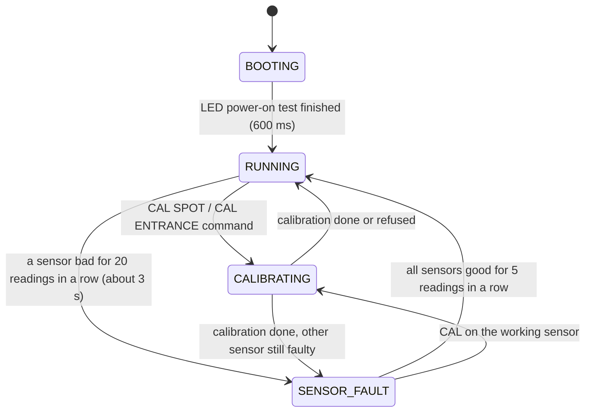
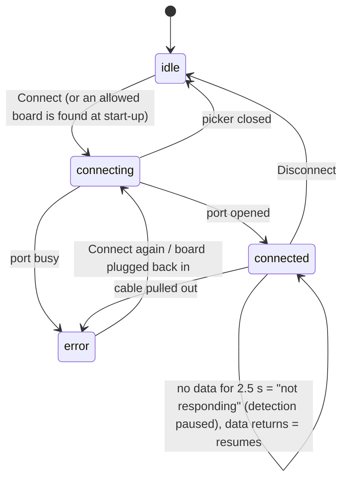

# State machines

## Sensor node (firmware)

All mode switching is in one function, `nextState()` in `hardware/smart_parking/state_machine.h`.
It looks at three facts and picks the mode, in this order of priority:

| State | What it means | LED strip | `state` in the status line |
| --- | --- | --- | --- |
| BOOTING | power-on LED test | all blue, steady | `BOOTING` |
| RUNNING, spot free | normal | all green | `RUNNING` |
| RUNNING, spot taken | normal | all red | `RUNNING` |
| CALIBRATING | measuring a sensor with the car in place (1.5 s) | all blue, fast blink | `CALIBRATING` |
| SENSOR_FAULT | a sensor is unplugged, shorted or noisy; its readings are ignored | all orange, slow blink | `SENSOR_FAULT` |

Mock mode is a flag, not a state: with it on, the board runs normally but takes its numbers from a
generated scenario instead of the sensors, and the **last LED turns violet** so nobody mistakes
generated data for real data.

The link to the app is a flag too. While the web app is connected it sends `PING` every second. If
it goes quiet for 3 s (the tab was closed, the app disconnected, the laptop slept) the **first LED
blinks amber**, and blinks **cyan** if WiFi is switched on and the network is gone. Only the first LED,
half of the time: the spot colour stays visible, and the board keeps deciding open / taken on its own.
A board that never had an app connected shows no warning, because working alone is normal for it
(`link_monitor.h`).

**Inputs that change things**

| Input | Effect |
| --- | --- |
| BOOT button, short press | mock mode on / off |
| BOOT button, long press (2 s) | restore default settings |
| USB commands (see below) | settings, mock, calibration, debug, reset, reboot |

**USB commands** (type them in any serial terminal at 115200 baud, or use the app's technician panel):

| Command | Does |
| --- | --- |
| `HELP` | lists the commands |
| `GET` | shows the settings |
| `SET SPOT_CM <5-60>` / `SET ENTRANCE_CM <5-60>` | detection distance, saved in flash |
| `SET BRIGHTNESS <0-120>` | LED brightness, saved in flash |
| `CAL SPOT` / `CAL ENTRANCE` | calibrate with the car in place |
| `MOCK ON` / `MOCK OFF` | generated sensor data |
| `DEBUG ON` / `DEBUG OFF` | also print raw ADC values and voltages |
| `RESET` | restore default settings |
| `REBOOT` | restart the board |
| `PING` | "the app is still here" (sent every second by the app; no reply) |

Bad input gets an `{"err":"..."}` reply and is otherwise ignored.

## Web app connection

Details: [docs/EDGE_CASES.md](EDGE_CASES.md).
